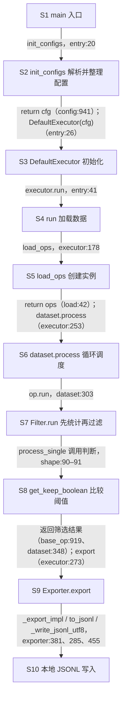

# Data-Juicer 最小调用链：源码核对说明

## 分析范围与假设

- 核对日期：2026-09-20；本地源码 HEAD：`cc914ee`。本次只修改文档，没有重新运行数据实验。
- 主交付是[完整调用图](../../learning/03-框架调用链/03-A-实际调用图.md)和[阈值传递过程](../../learning/03-框架调用链/03-B-min_width-340的传递过程.md)；[学习笔记第 3 节](../../learning/03-框架调用链/03-最小调用链.md)保留原有理解并链接两份回答。
- 使用[配置 A](../../learning/02-单算子实验/experiments/config-min-width-340.yaml)的 `default`、单图样本、本地不分片 JSONL 路径；假设无额外命令行或环境变量覆盖。
- 不展开 Ray/Spark、融合、checkpoint、tracer、DAG 或第三方数据集调度细节。预检、错误包装等在补充分析中说明，不当成已经动态验证。

## 核心流程分解

简称和逐箭头证据完整列在[调用图回答的源码表及四张图](../../learning/03-框架调用链/03-A-实际调用图.md)。核心证据：

| 步骤 | 源码 |
|---|---|
| S1–S2 入口与配置 | [入口第 18–41 行](../../data-juicer/tools/process_data.py#L18-L41)、[配置第 846–941 行](../../data-juicer/data_juicer/config/config.py#L846-L941) |
| S3–S5 执行器、读数据、创建实例 | [执行器第 41–178 行](../../data-juicer/data_juicer/core/executor/default_executor.py#L41-L178)、[load_ops 第 17–42 行](../../data-juicer/data_juicer/ops/load.py#L17-L42) |
| S6 算子循环 | [dataset.process 第 289–303 行](../../data-juicer/data_juicer/core/data/dj_dataset.py#L289-L303) |
| S7–S8 统计、判断 | [Filter.run 第 887–919 行](../../data-juicer/data_juicer/ops/base_op.py#L887-L919)、[图像尺寸方法第 60–100 行](../../data-juicer/data_juicer/ops/filter/image_shape_filter.py#L60-L100)、[下限比较第 844 行](../../data-juicer/data_juicer/ops/base_op.py#L844) |
| S9–S10 导出与落盘 | [调用第 273 行](../../data-juicer/data_juicer/core/executor/default_executor.py#L273)、[写入第 410–455 行](../../data-juicer/data_juicer/core/exporter.py#L410-L455) |

## 系统交互说明

这是 Python 同进程方法调用，核心数据对象为 `cfg`、`cfg.process`、算子实例列表、带 `stats` 的数据集和布尔保留值。输入为本地 YAML、JSONL 与图片；输出为本地 JSONL。文件 I/O 使用路径与 UTF-8 文本语义，不是 RPC。

第三方 `jsonargparse` 通过 `ActionConfigFile` 读取 YAML，[读取文本第 666 行](../../data-juicer/.venv/lib/python3.11/site-packages/jsonargparse/_core.py#L666)，[合并配置第 157–158 行](../../data-juicer/.venv/lib/python3.11/site-packages/jsonargparse/_actions.py#L157-L158)。库源码来自本地虚拟环境，链接与行号依赖当前环境。Hugging Face datasets 的底层调度未展开分析。

## 微服务与跨工程调用分析

本范围未发现需要展开的微服务调用，无 HTTP/RPC 协议、服务超时、熔断或分布式事务。`jsonargparse` 和 datasets 是同进程第三方依赖，不应误画成远端服务。[系统交互图](system-interaction.puml)用分组区分本项目、第三方库和本地文件系统。

## 异常与边界条件

- 配置解析或校验失败时不能继续按成功链推导；[配置收尾第 1335–1341 行](../../data-juicer/data_juicer/config/config.py#L1335-L1341)还会再次调用解析器校验，不可声称全程只解析两次。
- 严格预检有实例化前后两段，见[执行器第 158–188 行](../../data-juicer/data_juicer/core/executor/default_executor.py#L158-L188)。它们失败时不能假设算子已正常运行。
- 图片统计已存在时复用；样本没有图片时保留，见[算子第 62–69、86–87 行](../../data-juicer/data_juicer/ops/filter/image_shape_filter.py#L62-L87)。多图按 `any/all` 合并，不是一张图失败就必然删整条样本。
- 样本处理异常经[包装器第 69–83 行](../../data-juicer/data_juicer/ops/base_op.py#L69-L83)处理：`skip_op_error=False` 时重新抛出；为真时记录错误并返回空批。因此空输出不一定全由阈值过滤造成。
- `reduce=False` 只统计不执行过滤；本次 `op.run` 未传该参数，使用默认真值，见[第 887、898 行](../../data-juicer/data_juicer/ops/base_op.py#L887-L898)。
- 打开监控会从直接调用变成监控包装调用；导出分片、远端存储和跳过导出均非主图范围。

## 一致性与风险点

- 注册表存的是类，`load_ops()` 创建实例；不能把注册与实例化混为一谈。
- `Filter.run()` 的 `self` 仍是 `ImageShapeFilter` 实例；统计与处理的实例属性由父类初始化绑定。这解释了为何子类文件中找不到 `compute_stats` 或 `run` 定义。
- 本配置 `np: 1`，这里不展开多进程调度；包装函数存在不代表另一个服务或另一个父类实例。
- 本地写入用 `open(..., 'w')` 覆盖目标，既没有数据库事务，也没有临时文件原子替换。异常可能留下部分结果；重跑可能覆盖旧结果，不能宣称 exactly-once 或事务回滚。
- 图中不假设有自动重试；本范围没有重试成功的动态证据。图表与源码静态核对不替代输出文件内容验证。

## PlantUML 格式校验结果

附属图为[核心活动图](flow-core.puml)与[系统交互图](system-interaction.puml)。当前没有可用的 `plantuml-check` skill，改用临时目录中的 PlantUML 1.2025.2 引擎直接校验。

2026-09-20 执行结果：

- PlantUML：`java -Djava.awt.headless=true -jar /tmp/dj-callchain-check/plantuml.jar -checkonly docs/code-analysis/flow-core.puml docs/code-analysis/system-interaction.puml`，使用本机 OpenJDK 11，退出码 `0`，两张图语法检查通过。首次未启用 headless 的进程异常退出，改用 headless 后重新核对通过。
- Mermaid（初版）：原有 6 张图曾全部通过 `mermaid.parse()`。随后按学习者要求，将两份回答中的 3 张直线流程图改为文本调用树，保留调用与返回层级。
- 调用树改版后重新检查：两份回答不再含直线 `flowchart`；保留的 2 张时序图与本报告的 1 张概览图，共 3 张 Mermaid 解析通过。调用树中的赋值、循环和返回单独标注，不把顺序步骤冒充直接调用。
- 相对链接与源码行号：校验两份回答、主笔记及本报告中的本地链接存在性、`#L...` 行号范围；通过。原有个人理解保留，验收复选框未勾选。
- 上述是图表语法和文档静态检查，不包含图形截图验收，也不包含数据实验重跑。

## 待确认流程清单

- 本次不采集新的实验日志、不重新读取输出以宣称实验成功；学习验收保持未完成。
- 第三方库完整调度、缓存复用的实际命中情况不在静态图的证明范围。
- 两份回答的源码主链已覆盖，语法与相对链接检查已通过；不能将静态图混同于实际运行 trace。
