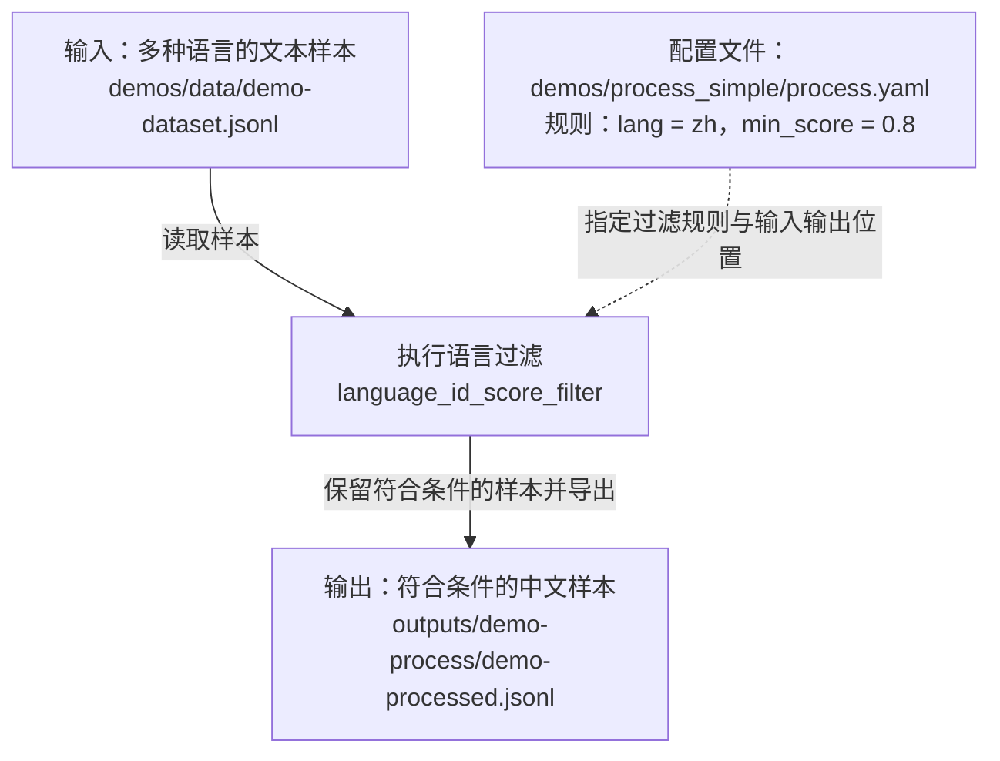

# 01－流程地图：先知道各部分在做什么

> 状态：已完成宏观认知学习，通过互动问答概念验收（2026-09-13）；不代表实验验证通过。
> 目标：用自己的话讲清全流程与框架职责，不要求读懂源码实现。
> 本地代码参考：Data-Juicer `cc914ee`（2026-09-13 检查时版本）。
> 返回：[学习导航](../README.md)

## 零、先学再画：从哪里开始

**今天先读材料，不安装、不运行，也不要求先懂源码。** 建议 40–60 分钟；时间不足就分两次。

### 第一步：读中文快速上手（必读，15–20 分钟）

打开 [QuickStart_ZH.md](../../data-juicer/docs/tutorial/QuickStart_ZH.md)，跳过第 1 节安装，依次读第 2–5 节：

| 章节 | 带着什么问题读 |
|---|---|
| 2. 了解输入数据 | 一行 JSON 表示什么？文本和元数据分别在哪里？ |
| 3. 编写菜谱 | `dataset_path`、`process`、`export_path` 各规定什么？ |
| 4. 运行流水线 | 命令接收什么配置，框架按什么规则执行？ |
| 5. 查看输出 | 哪些样本被保留，结果写在哪里？ |

本例使用文本，只保留满足语言条件的样本。先用这个熟悉的过滤逻辑理解框架，再换成图片。跳过安装命令、分析器扩展链接和“下一步”的延伸阅读。

### 第二步：认识处理积木（必读，5–10 分钟）

打开 [Operators.md](../../data-juicer/docs/Operators.md)，只看开头中文介绍和 `Overview 概览` 表，暂不读后面长列表。

先区分四类：formatter 加载与规范化、mapper 编辑转换、filter 保留或丢弃、deduplicator 去重。

带着问题读：**修改一条样本和丢弃一条样本有什么区别？去重为什么是另一类工作？**

若“谁负责执行”仍不清楚，可选读 [ProcessData_ZH.md](../../data-juicer/docs/ProcessData_ZH.md) 的“CLI 方式 → 基本用法”和“Python API 方式 → 方式一：加载菜谱”，只识别配置与执行器的关系，跳过其他 API 和优化内容。

### 第三步：画第一张小图（10 分钟）

先画教程中的文本例子，不要求马上画图像全流程。

#### 我的初稿（保留学习过程）

```text
输入数据：_./demos/data/demo-dataset.jsonl___ → 配置规则：_./demos/data/demo-dataset.jsonl___ → 执行处理：__dj-process --config demos/process_simple/process.yaml__ → 输出结果：__./outputs/demo-process/demo-processed.jsonl
__
```

#### 讨论后的修正版（助手协助整理）

初稿已经找到了输入、启动命令和输出。需要修正的是：**配置规则误填成了输入数据路径**。配置文件应为 `demos/process_simple/process.yaml`，其中 `lang: zh`、`min_score: 0.8` 才是本例的过滤规则。

为了不把数据、文件和动作混在一起，用实线表示数据流动，用虚线表示配置控制处理：



启动这条流程的命令（在 `data-juicer/` 目录下）：

```bash
dj-process --config demos/process_simple/process.yaml
```

如果预览器不支持 Mermaid，可先看这一行：

```text
多语言文本样本 → 按配置进行语言过滤（中文，识别分数达到 0.8）→ 符合条件的中文样本
```

**数据是原料，配置是处理说明书，命令负责启动。** 配置文件还指定输入和输出位置；它不是另一份待处理数据。

> 这张图来自教程阅读，本次尚未实际运行。图由助手协助整理，不代表已完成个人理解验收。

初次验收：能解释输入是什么、哪条规则决定保留、结果放哪里。此时不要求解释源码调用链，也不把教程展示的结果当作自己的实测结果。

### 第四步：再迁移到图像（可以留到下一次）

读完前两份材料后，再看本文第一节的宏观图和第二节的图像材料，尝试回答第三节五个问题。不懂写“待确认”，不需要当天完成全部内容。

遇到卡点：指出不懂的具体句子、字段或箭头，由助手补解释或例子，再继续；不转去通读源码或补整套深度学习课程。

## 一、先看两张不同的图

### 业务 / 数据流程：为什么处理这些数据

```text
有权使用的原始图片 + 元数据
    → 有效性检查 / 过滤 / 去重等加工
    → 质量核对
    → 图片与样本清单交付
    → 供训练、检索或业务分析使用
```

这是通用学习示意，不代表当前实验已实现全部环节。第一份实验只需要其中一个过滤步骤。

### 框架职责：谁把处理规则执行起来

```text
输入样本 ─────────────┐
                     ↓
流程配置 → 执行器 → 算子处理 → 输出样本
                                  ↓
                               核对结果
```

| 部分 | 先这样理解 | 数仓类比 |
|---|---|---|
| 输入样本 | 描述待加工数据的记录，可关联外部图片 | 源表记录及文件引用 |
| 流程配置 | 规定输入输出、处理步骤与参数 | 作业配置 |
| 执行器 | 组织并驱动处理过程 | 作业执行部分 |
| 算子 | 完成一个具体的加工或判断 | 一步转换或过滤 |
| 输出 | 处理后的样本及相关产物；实际有哪些需检查 | 结果表与交付文件 |

注意：过滤掉一条样本，不应直接理解成删除原始图片；具体媒体是否被写入或修改，要查看实际配置与行为。

## 二、已有的本地阅读入口

完成第零节的教程阅读后，再打开前两项；其余只用于定位，不要求现在通读。

1. [已有 smoke-image 配置](../../data-juicer/outputs/smoke-image/20260913_031905_ffae59/smoke_image.yaml)
2. [已有输出清单](../../data-juicer/outputs/smoke-image/res.jsonl)
3. [图像宽高过滤说明](../../data-juicer/docs/operators/filter/image_shape_filter.md)
4. [运行入口](../../data-juicer/tools/process_data.py)
5. [默认执行器](../../data-juicer/data_juicer/core/executor/default_executor.py)

此前检查已确认运行入口包含以下结构：

```text
init_configs() → 根据 executor_type 创建执行器 → executor.run()
```

这三段对应“读规则 → 准备执行 → 开始执行”。内部怎样加载数据、构造算子、传递样本，留到 03 笔记验证。

已查看配置，包含 `image_shape_filter`、`image_blur_mapper`、`image_deduplicator`。注意配置注释中的“模糊图识别”不准确：[image_blur_mapper 源码](../../data-juicer/data_juicer/ops/mapper/image_blur_mapper.py)实际按概率给图片添加模糊效果，不是检测模糊图。本轮没有复跑或完整核验结果，不据此认定实验成功。

## 三、图像迁移练习：完成前置阅读后再填写

尽量每题写 1–3 句话。不会的地方写“待确认”，不要直接复制上面的解释。

1. **输入是什么？图片本身和样本清单是什么关系？**
   - 我的理解：输入的是三张图片及其描述，样本清单是一张表，记录图片位置和描述
   - 我看到的具体字段 / 路径：'./demos/data/demo-dataset-images.jsonl', 三张图片及其对应的三条描述
2. **配置负责规定什么？**
   - 我的理解：数据读取路径、处理步骤、输出路径
   - 我找到的一个实际参数：min_width: 32 ,min_height: 32
3. **算子和执行器有什么区别？**
   - 我的理解：算子是提前准备好的数据处理方案（类似一个个函数），执行器是按照配置加载数据，执行算子和导出结果
4. **输出是什么？如何知道处理真的发生了？**
   - 我的理解：输出样本清单，里面包含图片和描述。要核验输出结果是否符合预期
   - 计划核对的证据：data-juicer/outputs/smoke-image/res.jsonl
5. **这条实验在完整多模态生产流程中的哪个位置？**
   - 我的理解：数据进入训练、检索等下游用途之前的数据预处理 / 加工环节
   - 它暂时没有解决的问题：没有结果核对？

### 本轮校正说明（助手补充，保留上方个人回答）

这版已说清配置、执行器和加工环节的主要职责。以下补充用于校准表述，不代表已完成个人理解验收或运行验证。

1. **输入：理解基本正确。** “样本清单是一张表”是合适的类比，但实际文件是 JSONL，每行一条样本。本例共三条，每条的 `images` 字段记录图片路径，`text` 字段记录文字描述；图片文件独立存放，不是直接装在清单里。
2. **配置：回答正确，再补上参数与顺序。** 配置规定数据读取路径、处理步骤及其顺序和参数、输出路径。这里 `min_width: 32`、`min_height: 32` 表示本例图片宽和高都至少为 32 像素才满足尺寸要求。仍需注意：配置中“模糊图识别”的注释不准确，`image_blur_mapper` 是按概率添加模糊效果，不是检测模糊图。
3. **算子与执行器：回答基本准确。** “算子类似一个个函数”的类比可以保留：算子负责具体处理，执行器负责按配置组织并调用它们，衔接数据加载和结果导出。
4. **输出：将“包含图片和描述”理解为“包含图片路径和描述”。** `res.jsonl` 是输出样本清单，不是图片文件本身；完整检查还要关注清单引用的图片。核验时，不只看文件是否存在，还要对比输入输出的条数、图片路径、图片尺寸和内容是否符合规则，并结合运行日志确认步骤执行情况。条数不变不代表没有处理，也不能仅凭一个输出文件认定整条流水线正确。
5. **流程位置：回答准确。** “没有结果核对？”更严谨的表述是“目前尚未完成结果核对”，而不是框架不能核对。这份小实验只覆盖局部加工，不代表已经完成完整质量验收或下游训练。

**第 4 题的核对示例（只说明检查方法，不作为本次实测结论）：**

- 对照[输入清单](../../data-juicer/demos/data/demo-dataset-images.jsonl)和[输出清单](../../data-juicer/outputs/smoke-image/res.jsonl)，查看样本是否保留、`images` 路径是否变化。
- 对于尺寸过滤，核对图片实际宽高与配置阈值；所有图片都满足条件时，全部保留也是合理结果。过滤样本不等于删除原始图片。
- 对于模糊处理，检查输出路径引用的文件是否存在，再比较对应原图与产物。该操作按概率发生，不能要求每张图都变化。

本轮仅校正文档，没有重新运行流水线或核验图片内容，下面的验收项保持未勾选。

## 四、疑问暂存区

| 问题 | 是否阻碍当前任务 | 何时处理 |
|---|---|---|
| 待填写 | 是 / 否 | 当前 / 02 实验 / 03 调用链 / 后续 |

遇到 embedding、Ray、GPU 等词先记在这里；若不影响解释当前五个框，不展开。

## 五、验收与下一步

### 阶段结论（2026-09-13）

**01 宏观认知阶段已完成，可以转入 02 单算子实验的学习准备。** 依据是个人笔记、修订和本次五题互动问答；采用逐题回答、反馈与追问的方式，不是独立计时的 3 分钟口述测试。

- [x] 经互动问答与追问，能区分输入、配置、执行器、算子、输出的核心职责。
- [x] 能指出已有配置和输出清单，并说明需要核对规则、文件存在性与可用性。
- [x] 能区分概念理解、输出记录和实际运行验证，不把有输出直接等同于加工成功。

### 问答验收记录

| 题目 | 个人回答与观察 | 结论 |
|---|---|---|
| 1. 串起尺寸过滤的五个部分 | 能指出阈值配置与 `image_shape_filter`；执行器起初回答“不清楚”，追问后解释“把这个过程串了起来并执行” | 经提示后理解，执行器职责需在实验中巩固 |
| 2. 输入输出条数相同是否代表未执行 | 回答可能全部满足条件，并提出输出图片尺寸统计核验 | 判断正确；助手补充用本次日志确认执行，用尺寸统计核对结果 |
| 3. mapper 与 filter 的区别 | 回答模糊 mapper 是模糊化加工，filter 是筛选 | 核心区别正确；助手补充 mapper 不仅适用于图片 |
| 4. 图片引用路径变化能证明什么 | 能发现路径、文件名变化，指出是否完成加工仍需检查 | 有证据边界意识；助手补充检查文件和日志，文字描述未变 |
| 5. 尺寸过滤后能否直接交付训练 | 提出核对预期、文件存在与可用性，并指出未解决去重、缺失问题 | 能区分局部加工与完整质量验收 |

### 保留的巩固点与边界

- 执行器组织运行，算子负责具体处理；前者在首题仍需提示，不记录为完全独立熟练复述。
- 结果符合规则，不单独证明算子执行过；要结合本次运行证据。
- 本次没有重跑流水线，没有新增图片内容核验，也没有验证训练可用性。
- 上方个人回答与早期校正说明保留，作为学习过程记录。

### 下一步

进入 [02 单算子实验](../02-单算子实验/README.md) 的准备阶段：先由助手补齐具体材料、阅读范围、顺序和核验方法，再创建 `../02-单算子实验/02-尺寸过滤实验.md`，开展“修改阈值 → 预测结果 → 运行 → 核对”的单算子练习。当前不要求理解完整源码调用链。
