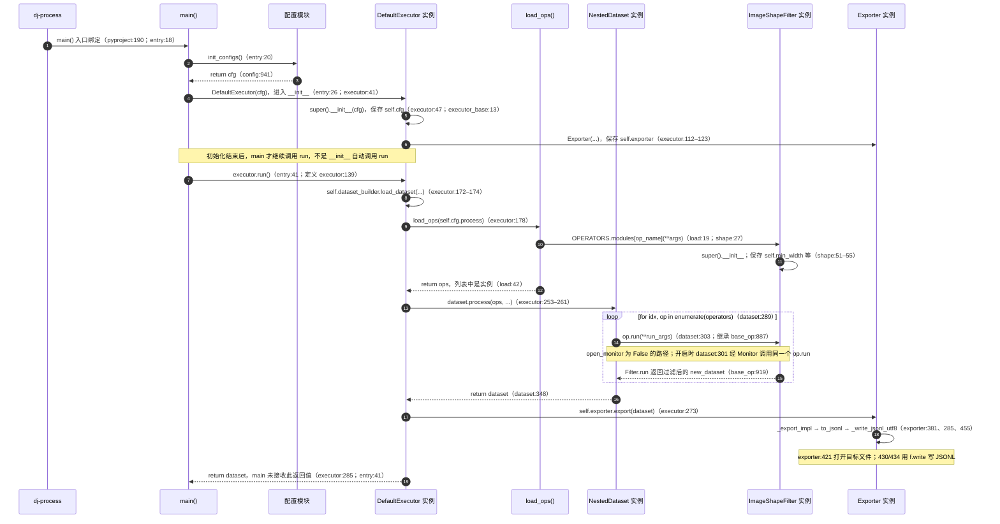
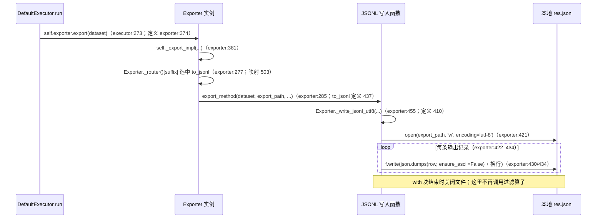

# 03-A－实际调用图：入口 → 配置 → 执行器 → 算子 → 输出

> 回答问题：画出实际调用图，每个箭头标注真实函数名和行号。
> 助手整理日期：2026-09-20；源码参考：Data-Juicer `cc914ee`。
> 验证边界：静态核对本地源码，本次未重新运行实验；不代替学习者个人验收。
> 返回：[最小调用链笔记](03-最小调用链.md) · 配套回答：[min_width: 340 的传递过程](03-B-min_width-340的传递过程.md)

## 1. 怎么读下面的图

**形式：主调用时序图 + 配置与算子两棵调用树 + 输出时序图。** 时序图用实线表示调用、虚线表示返回。调用树用缩进表示调用或代码块层级，同一级从上往下执行；`←` 标明返回位置，`[赋值]`、`[循环]`、`[with 代码块]` 等不是额外的函数。标有“省略调度层”的分支是库内部回调的简化展开，不是逐帧调用栈。

- 范围限定为[配置 A](../02-单算子实验/experiments/config-min-width-340.yaml)的 `default`、单个 `image_shape_filter`、本地单文件 JSONL 导出路径，不展开其他执行后端。
- 箭头中的行号优先表示**调用处**；写有“定义”时表示被调用方法的定义位置。代码简称对应下表中的可点击源码。
- 这是根据当前源码还原的学习导读，不是本次新采集的运行 trace，也不代表学习者已经完成验收。
- 为保持可读性，主图省略日志、计时、缓存、预检、DAG 记录等辅助步骤；省略不代表它们不存在。配置收尾、批处理包装和导出选择等容易造成“突然跳转”的位置单独展开。

| 图中简称 | 源码与本次阅读位置 |
|---|---|
| `pyproject` | [命令入口登记，第 189–190 行](../../data-juicer/pyproject.toml#L189-L190) |
| `entry` | [运行入口 `main()`，第 18–41 行](../../data-juicer/tools/process_data.py#L18-L41) |
| `config` | [`init_configs()`，第 846–941 行](../../data-juicer/data_juicer/config/config.py#L846-L941) |
| `executor` | [`DefaultExecutor`，初始化第 41–123 行，运行第 139–285 行](../../data-juicer/data_juicer/core/executor/default_executor.py#L41-L285) |
| `executor_base` | [`ExecutorBase.__init__()`，第 12–14 行](../../data-juicer/data_juicer/core/executor/base.py#L12-L14) |
| `load` | [`load_ops()`，第 4–42 行](../../data-juicer/data_juicer/ops/load.py#L4-L42) |
| `dataset` | [`NestedDataset.process()`，第 254–348 行](../../data-juicer/data_juicer/core/data/dj_dataset.py#L254-L348) |
| `base_op` | [`Filter`，初始化第 773–824 行，判断与运行第 841–919 行](../../data-juicer/data_juicer/ops/base_op.py#L773-L919) |
| `shape` | [`ImageShapeFilter`，第 12–100 行](../../data-juicer/data_juicer/ops/filter/image_shape_filter.py#L12-L100) |
| `exporter` | [`Exporter`，导出第 228–285、374–381、410–455、496–506 行](../../data-juicer/data_juicer/core/exporter.py#L228-L506) |

**建议阅读顺序**：先看第 2 节抓住入口的三个调用；卡在 YAML 时看第 3 节；卡在类、实例和继承时看第 4–5 节；最后看第 6 节如何写文件。不要一次追所有第三方实现。

## 2. 主调用图：入口 → 配置 → 执行器 → 算子 → 输出



**这张图回答“为什么跳到那里”**：函数执行完会回到调用它的那一行之后。`load_ops()` 返回后，执行器继续到 `dataset.process()`；`dataset.process()` 返回后，执行器继续到 `self.exporter.export()`。不是过滤器直接调用了最终导出。

`open_monitor` 未写在配置 A 中，[配置默认值第 437–440 行](../../data-juicer/data_juicer/config/config.py#L437-L440)为 `False`；主图按没有命令行或环境变量覆盖的情况画第 303 行。若启用监控，则经过[监控包装第 182–226 行](../../data-juicer/data_juicer/core/monitor.py#L182-L226)，最终仍执行传入的 `op.run`。

## 3. 局部图 A：只有文件路径，YAML 内容怎么进入 cfg？

### 初读只抓这条主线

结合[配置 A](../02-单算子实验/experiments/config-min-width-340.yaml)，先记住：

**找到 YAML → 读取配置 → 识别 `image_shape_filter` → 补齐它的参数 → 得到最终 `cfg`。**

| 主线步骤 | 对应代码 | 对本次实验的作用 |
|---|---|---|
| 找到 YAML | `args = sys.argv[1:]`，提取 `essential_args` | 从命令行拿到 `--config` 及配置文件路径；参数列表不包含 YAML 正文。 |
| 读取配置 | 第一轮 `parser.parse_args(args=essential_args)` | `--config` 触发文件加载，将 YAML 内容合并进解析结果。 |
| 识别 `image_shape_filter` | `yaml.safe_load(f)`，遍历 `config_data['process']` | 额外读取原始配置，提取算子名称，得到 `used_ops = {'image_shape_filter'}`。 |
| 补齐它的参数 | `_collect_config_info_from_class_docs(...)` → 第二轮 `parse_args(...)` → `init_setup_from_cfg(...)` → `update_op_process(...)` | 先补充解析规则，再解析、补公共属性并合并算子参数；保留 `min_width=340`、`min_height=1`，补齐其他未指定参数。不是这里就创建或执行算子。 |
| 得到最终 `cfg` | `return cfg`，由入口的 `cfg = init_configs()` 接收 | 把准备好的配置交给后续执行器；其中 `cfg.process` 会供 `load_ops()` 创建算子实例。 |

**第一遍可以暂时跳过**日志、缓存、分区兼容、配置备份和第三方库内部调度；先理解它们是辅助准备，不是图片尺寸判断。详细调用树较长，是因为 `init_configs()` 同时负责配置解析、兼容校验和运行准备，并非读取 YAML 本身需要这么多步骤。

### 详细调用树：需要时再展开

**先抓主线：命令行路径 → 读取配置 → 找出算子并补齐参数规则 → 完整解析 → 整理运行设置 → 返回 cfg。** 以下“作用 / 数据变化 / 本次”是步骤说明，不是额外的函数调用。作用说明于 2026-09-29 静态核对本地源码补充，未重新运行实验。

```text
init_configs()                                         [entry:20；定义 config:809]
│
├─ [赋值] args = sys.argv[1:]                           [config:846–847]
│         只有 --config 和文件路径，不含 YAML 内容
│
├─ build_base_parser()                                 [config:850]
│  作用：创建解析工具，规定支持哪些参数、类型和默认值；此时还没有读取本次命令行。
│  ├─ 创建 ArgumentParser，建立互斥参数组               [config:103、106]
│  ├─ add_argument('--config', action=ActionConfigFile) [config:107]
│  │  作用：让 --config 不只是普通字符串参数，而是触发配置文件加载的入口。
│  └─ ← 返回 parser，交给 init_configs 继续使用
│
├─ [准备] 提取 essential_args                          [config:852–868]
│  作用：只保留 --help、--config 及其路径、--auto；本次只有 --config，所以它与 args 内容相同。
│
├─ parser.parse_args(essential_args)                   [config:871]
│  作用：按基础规则完成第一轮解析，获得配置路径等信息；这一步也会加载 YAML，不是“只注册”。
│  ├─ [库内部识别 --config，省略解析器调度层]
│  │  └─ ActionConfigFile.__call__()                    [_actions:97]
│  │     └─ apply_config(...)                          [_actions:103]
│  │        ├─ parser.parse_path(value)                [_actions:156]
│  │        │  ├─ fpath.read_text()                     [_core:666]
│  │        │  │  数据变化：配置文件路径 → 文件中的文本内容。
│  │        │  ├─ self.parse_string(content=...)        [_core:667–674]
│  │        │  │  数据变化：文本 → 解析器可处理的结构化配置，并按当前规则处理。
│  │        │  └─ ← return parsed_cfg                   [_core:677]
│  │        └─ merge_config(...)，更新当前配置对象       [_actions:157–158]
│  │           作用：把读到的文件配置合并进本轮解析结果，而不是只保留文件路径。
│  └─ ← return parsed_cfg，赋给 essential_cfg          [_core:509；config:871]
│
├─ [with 代码块] open(配置路径)                         [config:877]
│  作用：额外读取一次原始 YAML，目的是识别算子；不是直接用这个字典替换 cfg。
│  ├─ yaml.safe_load(f)                                [config:878]
│  │  └─ ← 返回原始配置字典，赋给 config_data
│  └─ [循环] 从 config_data['process'] 提取 used_ops    [config:880–882]
│     本次结果：used_ops = {'image_shape_filter'}；这是算子名称集合，还不是算子实例。
│
├─ sort_op_by_types_and_names(...)                     [config:885]
│  作用：将注册表中的算子按类型和名称排序；下一步仅挑出 used_ops 中的算子。
├─ _collect_config_info_from_class_docs(...)           [config:888–890]
│  └─ 修改 parser：补充本次算子的参数规则，再返回
│     作用：add_class_arguments 从算子类提取参数定义，原地修改同一个 parser；不执行算子。
│     本次补充 image_shape_filter 的参数规则；返回的 op_params 字典未被调用处接收。
│
├─ parser.parse_args(args)                             [config:894]
│  作用：用补齐规则后的 parser 解析全部命令行参数与文件配置，得到 cfg。
│  注意：本次输入列表虽与第一轮相同，但 parser 已变化；parse_args 不靠调用次数区分行为。
│  ├─ [仍走上面的 ActionConfigFile 读文件与合并路径]
│  └─ ← 返回完整解析结果，赋给 cfg                      [_core:509；config:894]
│
├─ _normalize_partition_size_config(cfg)               [config:908]
│  作用：兼容旧分区字段、检查冲突、补分区默认值；本次 num_of_partitions 从 None 补为 4。
│  阅读边界：本次是 default 执行器，不使用这组配置切分数据；不是每次输入 4 张图，可先跳过。
├─ init_setup_from_cfg(cfg, load_configs_only)          [config:911]
│  作用：按 cfg 做运行准备，而不是开始图片过滤。
│  包括：整理本地绝对路径和任务目录、设置日志、检查 np、配置缓存。
│  本次还给算子补公共属性，如 image_key="images"、text_key="text"、num_proc=1、work_dir。
│  补充时保留算子已明确设置的值；本地相对路径基于运行工作目录，不是 YAML 所在目录。
│  └─ ← 返回处理后的配置，重新赋给 cfg
├─ update_op_process(cfg, parser, used_ops)             [config:914]
│  作用：把算子默认参数、process 中的配置及算子命令行覆盖值整理进最终 cfg.process。
│  本次保留 min_width=340、min_height=1，并补齐其余参数，供之后 load_ops 创建实例。
│  ├─ 合并参数、更新 cfg.process                       [config:1276–1315]
│  ├─ temp_parser.parse_args(temp_args) 再次校验        [config:1335–1341]
│  │  作用：构造临时参数再解析以检查配置；该调用的返回值未接收，不是执行图片过滤。
│  └─ ← return cfg                                     [config:1343]
│
├─ config_backup(cfg)，非 load_configs_only 时          [config:928]
│  作用：备份本次配置，便于追溯或复现实验；不改变图片筛选条件。
├─ display_config(cfg)，非 load_configs_only 时         [config:932]
│  作用：展示最终配置，便于确认文件参数、默认值及覆盖值共同形成的实际设置。
└─ ← return cfg，回到 main 的第 20 行完成赋值           [config:941；entry:20]
   输出：准备好的配置对象；此阶段没有返回图片数据，也没有创建或运行过滤算子实例。
```

**两次主要解析的区别不是 args 变成了 YAML 内容，而是第二次的 parser 已补齐算子参数规则。** 显式的 `yaml.safe_load()` 主要用来找 `process` 中的算子名，不是把它的结果直接赋给最终 `cfg`。

调用树里的 `parse_args()`、`yaml.safe_load()`、参数规则补充、配置收尾都是 `init_configs()` 发起的步骤；**不是 `yaml.safe_load()` 调用下一轮 `parse_args()`**。同级分支执行结束，回到 `init_configs()` 再继续下一项。

读文件藏在第三方库内部。树中的 `_actions` 和 `_core` 分别对应下表中的第三方库源码；这些行号来自本地虚拟环境，库版本变化后可能移动：

| 交接 | 真正做事的代码 |
|---|---|
| 遇到 `--config`，调用绑定的 action | [`ActionConfigFile.__call__()` 第 97–103 行](../../data-juicer/.venv/lib/python3.11/site-packages/jsonargparse/_actions.py#L97-L103)，调用 `apply_config()` |
| 用路径读取配置 | [`apply_config()` 第 156 行](../../data-juicer/.venv/lib/python3.11/site-packages/jsonargparse/_actions.py#L156)，调用 `parser.parse_path(value)` |
| 真正读取文本、解析内容 | [`parse_path()` 第 664–674 行](../../data-juicer/.venv/lib/python3.11/site-packages/jsonargparse/_core.py#L664-L674)：`fpath.read_text()`，再调用 `parse_string(content=content, ...)` |
| 把文件配置合并进当前配置对象 | [`apply_config()` 第 157–158 行](../../data-juicer/.venv/lib/python3.11/site-packages/jsonargparse/_actions.py#L157-L158)：`merge_config(...)` 后更新配置对象 |
| 返回解析结果 | [`parse_args()` 第 509 行](../../data-juicer/.venv/lib/python3.11/site-packages/jsonargparse/_core.py#L509)：`return parsed_cfg`，被调用处的 `cfg = ...` 接收 |

**不要把“第 894 行得到 cfg”当成初始化已经结束**：第 911、914 行还会更新它；`update_op_process()` 在[第 1276–1315 行](../../data-juicer/data_juicer/config/config.py#L1276-L1315)合并参数并更新 `cfg.process`，在[第 1335–1341 行](../../data-juicer/data_juicer/config/config.py#L1335-L1341)还会带配置路径再次解析校验。因此整个初始化过程不止两次解析；这里的“第一轮、第二轮”特指 `init_configs()` 主体的第 871、894 行。

## 4. 注册、创建实例、调用方法，是三件事

**① 导入时注册类，不是 load_ops 注册。**

导入[算子包第 18 行](../../data-juicer/data_juicer/ops/__init__.py#L18)时，会导入 `filter`；[过滤器包第 15 行](../../data-juicer/data_juicer/ops/filter/__init__.py#L15)再导入 `ImageShapeFilter`。定义类时执行[第 12 行的注册装饰器](../../data-juicer/data_juicer/ops/filter/image_shape_filter.py#L12-L14)，在[注册器第 82 行](../../data-juicer/data_juicer/utils/registry.py#L82)保存名字与类的对应关系。它发生在调用 `load_ops()` 之前，注册表是当前进程内存中的字典，不是安装时写好的永久记录。

**② load_ops 查表并创建实例。** 以下是便于理解的拆写，实际表达式见[第 17–19 行](../../data-juicer/data_juicer/ops/load.py#L17-L19)：

```python
op_name = "image_shape_filter"
args = {"min_width": 340, "min_height": 1}  # 只展示 YAML 明写的参数
op_class = OPERATORS.modules[op_name]       # 类：ImageShapeFilter
op = op_class(**args)                      # 实例：进入 __init__
ops.append(op)                            # 列表里装的是实例
```

实际 `args` 还可能包含配置初始化补齐的默认参数和公共属性，不只有这两个字段。两个阈值放在同一个参数字典中，不是两个算子。

**③ dataset.process 循环调用实例。** [第 289 行的 `for`](../../data-juicer/data_juicer/core/data/dj_dataset.py#L289-L303)取出 `op`，第 303 行调用 `op.run(...)`。`ImageShapeFilter` 没有定义自己的 `run()`，所以使用继承的 `Filter.run()`；此时 `self` 仍然是同一个 `ImageShapeFilter` 实例，不会换成另一个父类实例。

## 5. 局部图 B：Filter.run 先统计，再筛选

**先抓主线：输入样本 → 准备统计字段 → 读图记录宽高 → 按阈值判断 True/False → 返回保留样本。** [配置 A](../02-单算子实验/experiments/config-min-width-340.yaml)使用[示例数据集](../../data-juicer/demos/data/demo-dataset-images.jsonl)，当前文件有 3 条样本、每条引用一张图；以下说明以这条路径为例，不将静态分析当成新运行结果。

**先说明 self.compute_stats 从哪里来。** 创建实例时，[`ImageShapeFilter.__init__()` 第 51 行](../../data-juicer/data_juicer/ops/filter/image_shape_filter.py#L51)调用父类初始化；[`Filter.__init__()` 第 811–816 行](../../data-juicer/data_juicer/ops/base_op.py#L811-L816)把批处理方法包装后分别赋给 `self.compute_stats`、`self.process`。本算子的[第 25 行](../../data-juicer/data_juicer/ops/filter/image_shape_filter.py#L25)设置了 `_batched_op = True`。

```text
NestedDataset.process()                               [定义 dataset:254]
└─ [循环] for idx, op in enumerate(operators)          [dataset:289]
   作用：按配置顺序取出已创建的算子实例；本次列表只有一个 ImageShapeFilter。
   └─ op.run(**run_args)                               [dataset:303]
      └─ 执行继承的 Filter.run()，self 仍是 op         [定义 base_op:887]
         作用：用父类提供的“统计 → 筛选”流程，调用当前图片过滤器的具体实现。
         │
         ├─ super(Filter, self).run(dataset)           [base_op:888]
         │  └─ OP.run()：通用准备，必要时补 stats 列  [base_op:603、619–631]
         │     作用：统一数据集包装，并为样本准备统计字段容器；这里还没计算图片宽高。
         │     └─ ← 返回 dataset                      [base_op:640]
         │
         ├─ dataset.map(self.compute_stats, ...)       [base_op:889–895]
         │  作用：第一阶段，为样本补充图片宽高统计；正常路径下此阶段不按尺寸删除样本。
         │  ├─ [数据集库内部调度回调，省略转换包装层]
         │  │  └─ self.compute_stats：wrapper(...)     [绑定 812–814；定义 69]
         │  │     作用：提供数据格式转换与异常处理包装，再调用真正的批量统计方法。
         │  │     └─ method(...)                      [base_op:71]
         │  │        └─ compute_stats_batched(...)     [定义 base_op:851]
         │  │           ├─ [循环] 拆出样本            [base_op:854–855]
         │  │           │  作用：批量输入中逐条取样本，让单样本宽高统计逻辑复用在批处理中。
         │  │           │  ├─ self.compute_stats_single(...) [base_op:856]
         │  │           │  │  └─ ImageShapeFilter 的实现     [shape:60]
         │  │           │  │     ├─ 读图、写入宽高 stats     [shape:73–80]
         │  │           │  │     │  数据变化：图片路径 → 加载图片 → 宽度/高度列表，存入该样本 stats。
         │  │           │  │     │  已有统计时直接复用；无图片时写空统计列表，不在此处决定删除。
         │  │           │  │     └─ ← return sample         [shape:81]
         │  │           │  └─ [赋值] 回填样本 stats         [base_op:857]
         │  │           │     作用：将单条样本算出的统计放回当前批次，供后续筛选读取。
         │  │           └─ ← return samples           [base_op:861]
         │  └─ ← map 返回带统计的数据集，赋给 new_dataset [base_op:889]
         │
         ├─ [if reduce] new_dataset.filter(self.process, ...) [base_op:898、910–912]
         │  作用：第二阶段，依据回调的 True/False 保留或移除整条样本，不是裁剪图片。
         │  条件：reduce=True 才执行筛选；False 时只做统计，不按过滤条件减少样本。
         │  ├─ [数据集库内部调度回调，省略转换包装层]
         │  │  └─ self.process：wrapper(...)           [绑定 815–816；定义 69]
         │  │     作用：经过包装调用批量判断逻辑；这里的 process 是过滤判断，不是最终导出。
         │  │     └─ method(...)                      [base_op:71]
         │  │        └─ process_batched(...)          [定义 base_op:863]
         │  │           └─ ← 返回内置 map 的惰性迭代器 [base_op:864]
         │  │              作用：安排逐条计算布尔值，消费迭代器时才真正调用 process_single。
         │  ├─ [求值] 消费迭代器，逐条取得保留值
         │  │  └─ lambda 中的 self.process_single(...) [base_op:864]
         │  │     └─ ImageShapeFilter 的实现          [shape:83]
         │  │        ├─ 从 stats 取出宽高             [shape:84–85]
         │  │        │  作用：复用上一阶段的统计，不为阈值比较重新读取图片；无图片时直接返回 True。
         │  │        ├─ get_keep_boolean(w, ...)      [shape:90]
         │  │        │  ├─ 比较宽度下限、上限         [base_op:844、846]
         │  │        │  │  本次下限为 340 且默认包含边界，即检查宽度 >= 340，同时检查宽度上限。
         │  │        │  └─ ← return res_bool          [base_op:849]
         │  │        ├─ 宽度通过后 get_keep_boolean(h, ...) [shape:91；and 短路]
         │  │        │  └─ ← 返回高度是否满足阈值     [base_op:849]
         │  │        │     本次高度下限为 1；宽度不通过时 and 短路，不再计算该图片的高度条件。
         │  │        └─ ← any/all 合并成样本保留值    [shape:98/100]
         │  │           作用：多图样本将每张图的判断合并为一个布尔值；本次每条只有一张图。
         │  │           True 表示保留这条样本，False 表示过滤掉；方法本身不负责写文件。
         │  └─ ← filter 返回保留样本的数据集，更新 new_dataset [base_op:910]
         │
         ├─ free_models()                             [base_op:918]
         │  作用：通用模型资源清理；本次尺寸过滤不依靠模型推理，这不是另一轮筛选。
         └─ ← return new_dataset，回到 dataset.process 的赋值 [base_op:919；dataset:303]
            输出：过滤后的数据集；随后由外层执行器安排导出，过滤器不直接写最终 JSONL。
```

树中的 `process_batched()` 使用 Python 内置的 `map()` 返回惰性迭代器；消费迭代器时才逐条运行 `process_single()`。它与数据集的 `dataset.map()` 不是同一个方法。

这不是“一个样本在一个函数里立刻算完再删”，而是数据集层面的两个阶段：先 `map()` 生成统计，再 `filter()` 使用统计。图中省略了数据集库内部调度及 Arrow 转换包装；统计结果已存在时，[第 62–63 行](../../data-juicer/data_juicer/ops/filter/image_shape_filter.py#L62-L63)直接复用，不必重新解码图片。

对本次单图样本，宽度判断的关键调用是：

```python
# ImageShapeFilter.process_single，第 90 行
self.get_keep_boolean(w, self.min_width, self.max_width)

# Filter.get_keep_boolean，第 844 行
res_bool = res_bool and (val >= min_val if self.min_closed_interval else val > min_val)
```

这里 `w` 传给 `val`，`self.min_width`（340）传给 `min_val`。默认下限闭区间配置见[第 803 行](../../data-juicer/data_juicer/ops/base_op.py#L803)，所以执行 `>=`：`336 >= 340` 为假，`342 >= 340` 为真。最终还需要同时满足宽度上限和高度上下限；多图样本还要按 `any/all` 聚合，不能只凭一个宽度判断所有场景。

**返回路径**：[`Filter.run()` 第 919 行](../../data-juicer/data_juicer/ops/base_op.py#L919)返回过滤后的数据集，回到 [`dataset.process()` 第 303 行](../../data-juicer/data_juicer/core/data/dj_dataset.py#L303)的赋值；所有算子完成后，[第 348 行](../../data-juicer/data_juicer/core/data/dj_dataset.py#L348)再返回到执行器的第 253 行。随后才轮到导出。

## 6. 输出图：谁调用 export，res.jsonl 究竟在哪里落盘？

`self.exporter` 不是文件名：执行器初始化时在[第 112–123 行](../../data-juicer/data_juicer/core/executor/default_executor.py#L112-L123)创建 `Exporter` 实例并保存它，同时传入 `self.cfg.export_path`。因此执行器调用 `self.exporter.export(...)` 时，就能找到 `Exporter` 类中的方法。



本图限定 `export_ds=True`、不分片、无远端 `storage_options`、未跳过导出的本地 JSONL 路径。`_export_impl()` 可以先移除不保留的统计/哈希列，再写文件，但不是重新执行算子列表。

配置 A 指定的目标是[结果文件](../../data-juicer/outputs/size-filter-340/res.jsonl)；以仓库目录为运行工作目录时，对应配置中的 `./outputs/size-filter-340/res.jsonl`。**打开文件在第 421 行，真正写内容在第 430/434 行**，不能只停在 `export()` 的函数名上。

## 7. 如何自检

能否合上图说清“谁创建实例、谁循环调用、谁返回数据、谁写文件”？遇到不清楚的箭头，先点对应的调用行，再找对象的创建处；不要求先读完整条继承树。

第二个问题的逐站回答单独见 [03-B－min_width: 340 的传递过程](03-B-min_width-340的传递过程.md)。图中的辅助步骤和异常边界另有[源码核对说明](../../docs/code-analysis/analysis-report.md)，不作为本阶段必读材料。
