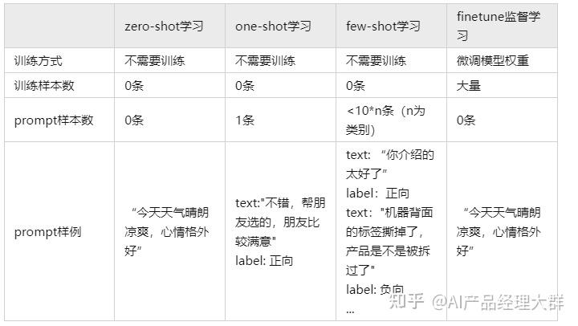
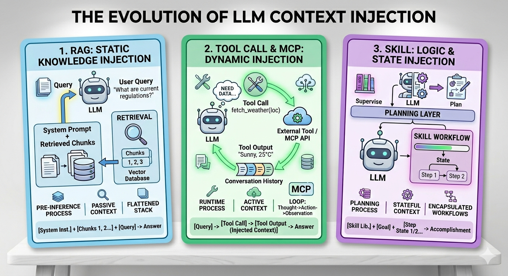

# From RAG to Skill：上下文工程的极致演进

> **时长**：30 分钟 | **关键词**：RAG, Tool Call, MCP, Skill, 上下文工程
>
> 返回 [总览](README.md) | 相关：[VLM → VLA](vlm-to-vla.md) · [Agent → OpenClaw](agent-to-openclaw.md) · [在线演示](online-demo.md)

### 分享时间分配（30 分钟）

| 章节 | 时长 | 要点 |
|------|------|------|
| 一、动机 | 2 min | 问题定义：知识边界 + 上下文工程 |
| 二、RAG | 3 min | 核心架构 + **被动上下文的局限**（重点批判） |
| 三、Tool Call | 5 min | 从被动到主动 + pydantic-ai 依赖注入 + 安全设计考虑 |
| 四、MCP | 3 min | 有状态连接 + "一切都是上下文" |
| 五、Skill | 5 min | 自然语言技能 + Playwright + **跨模型迁移** |
| 六、在线演示 | **10 min** | ⭐ Cooper 文档 5 阶段跃迁（现场演示） |
| Q&A | 2 min | |

---

## 一、动机：大模型的知识边界问题

### 1.1 问题定义

大模型（LLM）本质上是一个**压缩后的静态知识库**。它的能力边界由训练数据决定：

```
训练数据边界内  →  准确回答
训练数据边界外  →  幻觉（Hallucination）
```

这带来两个根本性挑战：

| 挑战 | 表现 | 举例 |
|------|------|------|
| **时效性** | 无法获取训练截止后的信息 | "最新的 Cooper 文档内容是什么？" |
| **专有性** | 无法访问私有/企业内部知识 | "我们团队的仿真任务配置是什么？" |

### 1.2 解决思路的演进

核心洞察：**一切能力扩展，本质上都是上下文工程（Context Engineering）**。



```
Few-shot Prompt → RAG → Tool Call → MCP → Skill
     ↓              ↓        ↓         ↓       ↓
  手工注入      自动检索  结构化调用  服务化   自主外化

注：这不是"新替旧"的线性演进，而是逐步扩大的外部能力注入手段。在实践中，
少样本学习（Few-shot）、RAG、Tool Call、MCP 和 Skill 通常是叠加关系，
共同构成现代大模型应用的能力框架。
```



每一步都在回答同一个问题：**如何更高效、更可靠地将外部知识注入模型的上下文窗口？**

### Comment（Review）

- 这条演进线很好懂，但也最容易被听众质疑成“线性替代史”。更稳妥的 framing 是：**Few-shot / RAG / Tool Call / MCP / Skill 是逐步扩大的外部能力注入手段，不是简单的新替旧。**
- 尤其 `MCP` 和 `Skill`，在很多场景里其实是叠加关系，不是前者被后者替代。

---

## 二、RAG：检索增强生成

### 2.1 核心架构

RAG（Retrieval-Augmented Generation）通过固定的工程流水线，在推理时动态注入相关上下文：

```
用户提问
   ↓
┌──────────────────────────────────────────────────────┐
│  Embedding Model    →  向量化查询                      │
│       ↓                                               │
│  Vector Database    →  相似度检索 (Top-K)               │
│       ↓                                               │
│  Retriever          →  重排序 + 过滤                    │
│       ↓                                               │
│  Context Builder    →  拼接检索结果到 Prompt             │
│       ↓                                               │
│  LLM Generator      →  基于增强上下文生成回答            │
└──────────────────────────────────────────────────────┘
```

### 2.2 核心组件

| 组件 | 职责 | 典型实现 |
|------|------|----------|
| **Embedding Model** | 将文本/图片映射到向量空间 | OpenAI `text-embedding-3`, BGE, Jina |
| **Vector Database** | 存储和检索高维向量 | FAISS, Milvus, Chroma, Qdrant |
| **Retriever** | 检索策略（稀疏/稠密/混合） | BM25 + Dense, ColBERT |
| **Reader/Reranker** | 精排 & 上下文压缩 | BGE-Reranker, Cohere Rerank |
| **Generator** | 基于增强上下文生成回答 | GPT-4, Claude, Qwen |

### 2.3 RAG 的局限性

RAG 在实践中暴露了若干系统性问题：

| 问题 | 描述 |
|------|------|
| **被动接受上下文** | 模型只能处理流水线塞进来的内容。即使检索结果有偏差，模型也无法说"这不对，让我换个方式搜"——它甚至不知道有其他文档存在 |
| **受制于小模型** | 检索质量取决于 Embedding 模型（通常 < 1B 参数）的语义理解。大模型的推理能力再强，也要被小模型的检索水平"卡脖子" |
| **语义空间不对齐** | 用户 query 和文档的 embedding 在同一向量空间中未必相近。"仿真任务配置"和"simulation job config"可能距离很远 |
| **不可逆的信息丢失** | 检索的 top-K 截断是一次性的。如果正确答案在第 K+1 个结果中，这一轮对话永远无法触达 |
| **上下文污染** | 检索到的低质量内容可能误导模型，产生比无上下文更差的输出 |
| **流水线复杂** | 5+ 个组件串联（Embedding → VectorDB → Retriever → Reranker → Generator），每个都需要维护和调参 |

> 💡 **本质问题**：RAG 是**预置上下文**的一种方案——将检索结果和用户 query 拼在一起传给大模型。一旦传入，木已成舟。模型即使发现上下文有困惑或遗漏，也无法重新检索来优化结果。大模型的推理能力被上游小 Embedding 模型的检索质量所制约，形成了**能力倒挂**。

#### Comment（Review）：RAG 批判

- 这一段批判力很强，但建议你主动补一句“**RAG 仍然是今天成本/工程成熟度最平衡的工业方案之一**”，否则会被问“既然这么差，为什么行业里还在大规模上 RAG？”
- “Embedding 模型通常 < 1B 参数”这个点更像经验判断，不建议讲得太实；重点讲**检索质量受上游表征制约**就够了。

---

## 三、Tool Call：结构化的能力扩展

### 3.1 从被动到主动

RAG 的核心局限在于**模型无法主动控制信息获取过程**——它只是被动消费流水线输出的结果。Tool Call 的诞生改变了这一局面：模型不再被动接收上下文，而是主动"伸手"获取信息，就像人打开浏览器搜索一样。

#### 技术演进路线

```
Structured Prompting (2022)
   "回答必须是 JSON 格式: {name: ..., age: ...}"
        ↓
Structured Decoding (2023)
   在解码层面约束输出 token 满足 JSON Schema
        ↓
Function Calling / Tool Call (2023-2024)
   模型原生支持工具调用协议
```

### 3.2 Tool Call 工作原理

```
用户: "帮我总结 Cooper 文档 2207460511730 的核心结论"
        ↓
┌─────────────────────────────────────────┐
│  LLM 推理（不直接回答，而是生成工具调用）    │
│                                          │
│  {                                       │
│    "tool": "read_cooper_document",       │
│    "arguments": {                        │
│      "resource_id": "2207460511730"      │
│    }                                     │
│  }                                       │
└─────────────────────────────────────────┘
        ↓
┌─────────────────────────────────────────┐
│  执行引擎：调用实际函数                     │
│  result = read_cooper_document(           │
│      resource_id="2207460511730"          │
│  )                                        │
└─────────────────────────────────────────┘
        ↓
┌─────────────────────────────────────────┐
│  LLM 再次推理：基于工具返回结果生成回答      │
│  "文档核心结论为：1. ... 2. ... 3. ..."    │
└─────────────────────────────────────────┘
```

### 3.3 OpenAI Function Calling 范式

```python
# OpenAI API 格式
tools = [{
    "type": "function",
    "function": {
        "name": "read_cooper_document",
        "description": "读取 Cooper 平台上的协作文档",
        "parameters": {
            "type": "object",
            "properties": {
                "resource_id": {
                    "type": "string",
                    "description": "文档的 resource_id"
                }
            },
            "required": ["resource_id"]
        }
    }
}]
```

### 3.4 pydantic-ai 实现（本项目使用）

```python
from pydantic_ai import Agent, RunContext

agent = Agent('openai:gpt-4o', deps_type=CooperDeps)

@agent.tool
async def read_cooper_document(
    ctx: RunContext[CooperDeps],
    resource_id: str,
) -> str:
    """读取 Cooper 平台上的协作文档内容。

    Args:
        resource_id: Cooper 文档的 resource_id
    """
    content = await ctx.deps.cooper_client.export(resource_id)
    return markitdown.convert(content)
```

#### 依赖注入与私钥隔离

pydantic-ai 的 `Deps` + `RunContext` 模式实现了一个关键的安全特性：**敏感信息不经过模型上下文**。

```python
@dc.dataclass
class CooperDeps:
    cooper_username: str     # 私钥/凭据存储在 Deps 中
    cooper_client: CooperClient  # 已认证的客户端

# 模型上下文中只看到工具的 description 和参数 schema
# 模型 ❌ 看不到 cooper_username 的值
# 模型 ❌ 看不到 API token/密钥
# 模型 ✅ 只能通过 RunContext 间接使用这些凭据
```

> 注：主流方案也多用 .env + 环境变量 存放私密凭据

这意味着：
- **Skill 文档可以开放共享**（SKILL.md 不含任何密钥）
- **工具代码可以开源**（Schema 公开，凭据运行时注入）
- **大模型无法泄漏机密信息**（私钥从未出现在上下文窗口中）

> 💡 对比传统方案：如果把 API Key 写进 System Prompt 或环境变量描述中，模型可能在输出中"回忆"并泄漏这些信息。依赖注入从根本上杜绝了这一风险。

#### Comment（Review）：安全表述

- “**大模型无法泄漏机密信息**” 和 “**从根本上杜绝**” 都太绝对。更安全的说法是：**显著降低敏感信息直接暴露给模型的概率和暴露面，但不等于系统级绝对安全。**
- 听众如果有安全背景，会继续追问：工具返回值里是否仍可能包含敏感信息？模型是否可能通过工具结果间接外泄？这块建议你主动承认边界。

### 3.5 Tool Call 相比 RAG 的优势

| 维度 | RAG | Tool Call |
|------|-----|-----------|
| 控制权 | 流水线决定检索什么 | **模型决定**调用什么工具、传什么参数 |
| 可观测性 | 特征空间操作，不透明 | 函数名 + 参数，**完全可审计** |
| 与人对齐 | 向量近似匹配，人类难以理解和优化 | 与人类行为一致（全文搜索、精确查询），**易于理解和优化** |
| 灵活性 | 只能做检索 | 可以执行任意操作（读、写、计算） |
| 迭代能力 | 一次检索定终身，无法根据结果调整策略 | 模型可多次调用工具，逐步精化 |

### 3.6 Tool Call 的局限

| 问题 | 描述 |
|------|------|
| **需要预定义 Schema** | 每个工具的参数、类型、描述都需要人工定义 |
| **缺乏灵活性** | 新任务 = 新工具 = 新代码，无法自适应 |
| **单轮上下文注入** | 每次调用都是独立的，工具之间无状态共享 |
| **注册中心缺失** | 工具散落在各处，模型不知道有哪些工具可用 |

---

## 四、MCP：工具调用的服务化

### 4.1 从函数到服务——一切都是上下文

MCP（Model Context Protocol）由 Anthropic 于 2024 年底提出，核心洞察：

> **工具调用不应该是一次性的函数调用，而应该是持久化的服务连接。**
> 本质上还是**上下文**问题：模型需要上下文，工具也需要上下文。

```
Tool Call（无状态）：
  每次调用 → 连接 → 执行 → 断开
  问题：每次都要重新传递"我是谁"、"我之前做了什么"

MCP（有状态）：
  建立连接 → 保持会话 → 多次调用 → 关闭连接
         ↑                  ↑
         └── 状态在服务端保持 ──┘
  优势：服务端记住上下文，客户端不需要重复发送
```

这与 OpenAI 从 HTTP REST API 转向 Realtime / WebSocket API 的趋势一致——HTTP 的无状态本质意味着每次请求都要携带完整上下文（对话历史、系统提示、工具定义），对话越长开销越大。**有状态连接是 AI 系统的必然演进方向**。

#### Comment（Review）：MCP 定位

> FIXME: 按评论进行修正，补充 mcp 特性：标准化热插拔 + 应用与工具可隔离（跨进程、机器、docker，更不容易 token泄漏）
- 这里最容易被挑刺的点是：**MCP 不是“状态化 Tool Call”这么简单，也不是所有 MCP server 都必须强状态。** 更稳妥的定义应是：MCP 提供工具 / 资源 / 提示词的标准化协议，状态能力是常见收益，不是唯一内核。
- “OpenAI 要弃用 HTTP” 这种隐含结论不要讲太满，建议收敛成“实时交互正在更多采用长连接/流式协议”。

### 4.2 MCP 架构

```
┌─────────────┐     MCP Protocol      ┌──────────────────┐
│  MCP Client  │ ←──────────────────→  │  MCP Server       │
│  (LLM/Agent) │                       │                    │
│              │  ← list_tools()       │  ┌──────────────┐ │
│              │  → tool results       │  │ Tool Registry │ │
│              │                       │  └──────────────┘ │
│              │  ← list_resources()   │  ┌──────────────┐ │
│              │  → resource content   │  │ Resources     │ │
│              │                       │  └──────────────┘ │
│              │  ← list_prompts()     │  ┌──────────────┐ │
│              │  → prompt templates   │  │ Prompts       │ │
└─────────────┘                       │  └──────────────┘ │
                                       └──────────────────┘
```

### 4.3 MCP 的三大能力

| 能力 | 说明 | 示例 |
|------|------|------|
| **Tools** | 可执行的函数 | `read_cooper_document`, `convert_to_markdown` |
| **Resources** | 可读取的数据源 | 文件、数据库记录、API 响应 |
| **Prompts** | 可复用的提示模板 | "分析这份文档并提取要点" |

### 4.4 MCP 解决了什么

| Tool Call 的问题 | MCP 的解决方案 |
|------------------|---------------|
| 无状态 | 服务端保持连接状态，支持会话 |
| 注册中心缺失 | `list_tools()` 自动发现可用工具 |
| 工具散落 | 标准化协议，任意语言实现、任意平台部署 |

### 4.5 实际示例：markitdown MCP Server

本项目已使用 markitdown 的 MCP Server：

```bash
# 启动 MCP Server
pixi exec markitdown-mcp-server

# Agent 自动发现 convert_to_markdown 工具
# 调用: convert_to_markdown(uri="file:///tmp/doc.docx")
# 返回: Markdown 文本
```

### 4.6 MCP 的局限

MCP 标准化了工具的发现和调用，但仍然需要**人工编写和部署**每一个 MCP Server。模型无法自己创建新的工具。

---

## 五、Skill：模型自主外化技能

### 5.1 5.1 从预定义到自主外化

Skill 是上下文工程的最新演进。核心突破：

> **模型不再需要预定义的 Schema，而是通过交互动态学习、外化和复用技能。**

```
Tool Call:  人类定义工具 → 模型调用
MCP:        人类部署服务 → 模型发现并调用
Skill:      模型自己学习 → 自己沉淀 → 自己复用
```

#### Skill 的精确定义

关于 Skill 的"学习"，这里指的**不是参数微调或内存写入**，而是**外部化的技能文档与可复用流程沉淀**：
- 这是全篇最容易被追问的一句。听众会马上问：**这里的“学习”到底是参数学习、memory 写入，还是生成了一个外部 SKILL.md artifact？**
- 你的材料里其实讲的是后者——**外部化的技能文档与可复用流程**。建议后面把“自主学习”改成“自主沉淀 / 自主外化 / 自主复用”，会更准确。

### 5.2 5.2 Skill 的文件结构

以 OpenClaw 和本项目的 Skill 系统为例：

```
skills/
├── reading-cooper-documents/    # 技能目录
│   └── SKILL.md                 # 技能定义文件
├── spark-job-submission-config/
│   └── SKILL.md
└── voyager-spark-sql-execution/
    └── SKILL.md
```

每个 `SKILL.md` 包含：

```markdown
---
name: reading-cooper-documents
description: 读取 Cooper 平台上的文档内容，供 Agent 分析和引用。
---

# Skill: Reading Cooper Documents

## Overview
Cooper 平台有两种文档类型...

## Step-by-Step Guide
### Step 1: 下载文档
### Step 2: 转换为 Markdown
### Step 3: 读取内容

## Troubleshooting
### 常见问题及解决方案
```

### 5.3 5.3 Skill 系统的工作流

```
┌───────────────────────────────────────────────────────────────┐
│                     Skill 生命周期                              │
│                                                                │
│  1. 发现 (Discovery)                                           │
│     Agent 扫描 skills/ 目录，读取 SKILL.md 的 metadata          │
│     → 建立可用技能索引                                          │
│                                                                │
│  2. 匹配 (Matching)                                            │
│     用户提出任务 → Agent 根据 description 匹配最相关的技能        │
│                                                                │
│  3. 执行 (Execution)                                           │
│     Agent 按 SKILL.md 中的 Step-by-Step Guide 执行              │
│     → 使用已有工具（bash、MCP server 等）完成操作                 │
│                                                                │
│  4. 学习 (Learning)                                            │
│     遇到新场景 → Agent 自主总结经验 → 创建新的 SKILL.md           │
│     → 下次遇到类似场景自动调用                                   │
└───────────────────────────────────────────────────────────────┘
```

### 5.4 5.4 Skill 与 Tool Call / MCP 的区别

| 维度 | Tool Call | MCP | Skill |
|------|-----------|-----|-------|
| 定义者 | 人类开发者 | 人类开发者 | **模型自己** |
| 格式 | JSON Schema | 标准协议 | **自然语言** (Markdown) |
| 灵活性 | 固定 | 可发现 | **可创建、可修改** |
| 知识载体 | 代码 | 服务 | **文档** |
| 共享方式 | 库/包 | 服务器 | **文件目录** |

### 5.5 5.5 Tool + Skill + MCP：完整工作流示例

在现代 Agent 系统中，Tool、Skill 和 MCP 通常一起打包使用：

#### 实际案例：Cooper 文档阅读

```
project/
├── pyproject.toml                 # 工具和 pixi task 定义
│   └── [tool.pixi.tasks]
│       cooper-read = "python -m lib.platforms.ep.cooper export --url ... | markitdown"
│
├── lib/platforms/ep/
│   └── cooper.py                  # MCP Server + 工具集实现
│       ├── CooperClient 类         # 核心 MCP 服务（状态化连接）
│       ├── export()                # Tool（导出文档）
│       ├── download()              # Tool（下载文件）
│       └── normalize_docx()        # Tool（修复 DOCX）
│
├── docs/skills/reading-cooper-documents/
│   └── SKILL.md                   # 技能文档（Agent 可读）
│       ├── 技能定义（Metadata）
│       ├── 使用场景说明
│       └── Step-by-Step 执行流程
│           │ 推荐：使用 cooper-read 一行命令
│           └── 手动调用 cooper export + normalize-docx + markitdown
```

#### 三层架构

| 层级 | 实现形式 | 调用方 | 特点 |
|------|---------|--------|------|
| **MCP Server** | 进程/服务 | Agent 通过 MCP 协议 | 有状态、可发现、跨机器 |
| **Tool** | Python 函数或 CLI 命令 | 脚本/Agent 调用 | 原子操作、组合灵活 |
| **Skill** | Markdown 文档 | Agent 自动理解、执行 | 人可读、模型可学习、可演进 |

**打包方式**：

1. **MCP Server**：通过 pyproject.toml 定义，Agent 启动时自动加载
   ```toml
   [tool.pixi.tasks]
   cooper-cli = "python -m lib.platforms.ep.cooper"
   ```

2. **Tool 组合**：在 Skill 文档中描述具体命令序列
   ```markdown
   # 推荐方式（一行命令）
   pixi run -e prod cooper-read <URL>
   
   # 手动分步
   pixi run cooper export - --url <URL> | pixi run cooper normalize-docx | markitdown
   ```

3. **Skill 注册**：放在 docs/skills/ 目录，Agent 自动扫描和加载
   - SKILL.md 中的 metadata 标记技能名称、描述、依赖
   - Step-by-Step Guide 提供执行步骤
   - 场景示例帮助 Agent 决策何时调用

#### 工作流示例

```
用户请求：帮我总结 Cooper 文档 xxx

Agent 流程：
1. 扫描 docs/skills/ → 发现 "reading-cooper-documents" 技能
2. 读取 SKILL.md → 理解技能入参（Cooper URL）和执行步骤
3. 匹配判断 → 用户请求符合此技能
4. 调用执行 → 按 SKILL.md 中的推荐方式：
   pixi run -e prod cooper-read https://cooper.didichuxing.com/docs2/document/xxx
   
   （内部编排）
   ├─ MCP 客户端连接到 cooper.py (MCP Server)
   ├─ 调用 cooper export tool → 下载 DOCX
   ├─ 调用 normalize-docx tool → 修复样式
   ├─ 调用 markitdown tool → 转换为 Markdown
   └─ 返回 Markdown 文本

5. 结果处理 → 基于 Markdown 内容进行分析/总结
6. 学习沉淀（可选）→ 如果场景新颖，创建新的 SKILL.md 或更新现有 SKILL.md
```

#### Claude Skill 示例

本项目 Skill 系统设计参考 Claude 官方 AI SDK：

- **claude-python SDK** 中的 Skill 概念：定义自动化工作流，Agent 可自主调用
- **打包方式**：Skill = Markdown SKILL.md + 对应的 Tool/Script
- **跨模型迁移**：Skill 以 Markdown 存储，Claude、GPT-4 等都能理解和使用

```python
# 本项目的 Skill 是"文档化的工具编排"，在 pydantic_ai 中体现为：
from pydantic_ai import Agent

agent = Agent(model='gpt-4')

# Agent 自动发现和理解 SKILL.md
# 当用户需求匹配 Skill 描述时，Agent 自动执行对应的 Tool 序列
result = await agent.run("帮我总结 Cooper 文档...")

# 等价于：
# 1. 加载 reading-cooper-documents SKILL.md
# 2. 理解 Step-by-Step 中的工具调用序列
# 3. 组合调用 cooper export → normalize-docx → markitdown
# 4. 返回 Markdown 结果供下游分析
```

### 5.6 5.6 代表性工作

### 5.7 5.6 代表性工作

| 项目 | 特点 | 时间 |
|------|------|------|
| **OpenClaw** | 开源自主 Agent，技能系统（SKILL.md），消息平台 UI | 2025.11 |
| **Claude Code** | Anthropic CLI Agent，bash + 文件系统，极简但强大 | 2025 |
| **GitHub Copilot CLI** | 技能系统 + 项目感知，开发者场景深度集成 | 2025 |
| **Voyager** (MineCraft) | 模型在游戏中自主学习技能库，技能可组合 | 2023 |
| **BAGEL** | 统一多模态理解与生成，开源基础模型 | 2025 |

#### Comment（Review）：代表性工作

- 这个表里 `Voyager` 很合适，`OpenClaw / Claude Code / Copilot CLI` 也能成立，但 `BAGEL` 放在这里会显得跳层——它更像基础模型，不像 Skill 系统代表作。
- 如果你想让这一页更“站得住”，建议把它讲成 **“Skill 相关生态样本”**，而不是“严格同类代表工作”。

### 5.8 5.6 延伸：MCP + 浏览器操控 — Skill 的杀手级应用

Playwright MCP Server 让模型能够像人一样操作浏览器。以"查内网审批单状态"为例：

```
用户: "帮我在内网查审批单状态"
    ↓
Agent 搜索 Skills → 找到 "internal-approval-checker"
    ↓
读取 SKILL.md → 学习步骤：
  1. 用 Playwright MCP 打开审批系统
  2. 登录（凭据通过 Deps 注入，不经过模型上下文）
  3. 导航到审批列表 → 搜索 → 截图
  4. 用 VLM 理解截图内容 → 提取审批状态
    ↓
如果 Skill 不存在 → Agent 试错 → 创建新 SKILL.md → 下次复用
```

#### 关键洞察：从规则到学习

在 Skill 框架下，浏览器交互从硬编码规则演进为模型自主学习：

| 阶段 | 方式 | 限制 |
|------|------|------|
| 传统自动化 | Selenium/硬编码规则 | 规则爆炸、难以维护 |
| 视觉 AI 时代 | VLM + 截图 | 计算开销大、隐私风险 |
| 结构化交互 | MCP 协议 + 语义理解 | 优雅、高效、模型无关 |

在这个框架中，Playwright 及其 MCP Server 提供了与浏览器交互的标准化接口。重点不在 Playwright 的细节，而在于：**通过标准协议和结构化数据表示，Agent 能够自主学习和复用网页交互技能**。

<details>
<summary>💡 内部备注：为什么选择这个例子做分享</summary>

1. **跨三个主题**：VLA（视觉 → 操作浏览器）+ Skill（自主学习）+ Agent（多步骤推理）
2. **听众共鸣**：每个人都有"在内网系统上反复点击"的痛点
3. **安全故事**：凭据通过依赖注入，模型上下文中看不到密码——直接呼应 3.4 节
4. **可现场演示**：Playwright MCP 已是成熟的开源项目
5. Selenium 为 QD 团队熟知

</details>

### 5.9 5.7 跨 Agent 技能迁移

Skill 系统最优雅的特性：**技能是纯文本文件，天然跨模型**。

```
Claude 创建 Skill：
  1. Claude Code 执行任务时遇到新场景
  2. 通过试错学会操作步骤
  3. 将经验保存为 SKILL.md

GPT 使用同一个 Skill：
  1. GPT 遇到类似任务 → 搜索 skills/ 目录
  2. 找到 Claude 创建的 SKILL.md → 阅读步骤
  3. 按步骤执行 ← 无需任何适配！

关键：SKILL.md 是自然语言，不是代码
      → 任何能读 Markdown 的模型都能理解和执行
```

> 💡 这可以作为**演示亮点**：现场展示 Claude 创建一个 Skill，然后切换到 GPT 直接使用——证明 Skill 是模型无关的。

### 5.10 5.8 技能共享生态

技能共享平台已经出现：

| 平台 | 说明 |
|------|------|
| **[SkillHub 技能广场](https://skillshub.intra.xiaojukeji.com)** | 公司内部技能共享平台 |
| **ClawHub**（OpenClaw） | 社区技能市场，类似 npm |
| **MCP Server 目录** | [mcp.so](https://mcp.so/)、Smithery 等 |

趋势：

1. **技能组合与编排**：复杂任务自动分解为技能链
2. **安全审计**：第三方技能的安全评估（OpenClaw 已暴露此问题）
3. **版本管理**：技能的迭代和回滚

---

## 六、在线演示设计：Cooper 文档的 5 阶段能力跃迁

> 用同一个任务——"理解并分析 Cooper 文档"——展示从 Plain LLM 到 Skill 的**模型能力递进**。
> 重点不是"读取"能力，而是理解、总结、推理能力的逐步解锁。

### 任务设计（递进式提问）

```
基础：  "帮我总结这份文档的核心结论"
进阶：  "文档中 DPE 和模型在拐点检测上的差异是什么？"
深度：  "文档中提到了哪些 TODO？请汇总成行动项"
交互：  "@文档中提到的作者，请他确认结论是否准确"（展示理解→行动）
```

### 任务定义

```
输入：Cooper 协作文档 URL
      https://cooper.didichuxing.com/docs2/document/2207460511730

期望：读取文档内容 → 理解 → 总结/回答问题/提取人员和行动项
```

### Stage 0：Plain LLM Output（无工具）

```python
# app: apps/skill_demo/stage0_plain.py
agent = Agent('openai:gpt-4o')

result = await agent.run(
    "帮我总结 Cooper 文档 2207460511730 的核心结论"
)
# 模型输出：幻觉！编造文档内容和结论
# 因为模型无法访问外部资源
```

**演示要点**：模型自信地编造了文档内容，但完全是错误的。

### Stage 1：RAG 方案

> 💡 TODO：考虑接入公司内部 RAG 服务作为演示

```python
# app: apps/skill_demo/stage1_rag.py
# 预处理：构建文档向量库
embeddings = embed(all_cooper_docs)
vector_db.add(embeddings)

# 运行时：
query_embedding = embed("Cooper 文档 2207460511730")
retrieved_docs = vector_db.search(query_embedding, top_k=3)

result = await agent.run(
    f"基于以下参考文档回答：\n{retrieved_docs}\n\n问题：..."
)
# 问题：
# 1. 需要预先索引所有文档
# 2. 检索到的可能不是目标文档（embedding 模型的语义理解偏差）
# 3. 流水线复杂（Embedding → VectorDB → Retriever → Generator）
# 4. 模型无法要求"换个方式搜"——被动接受检索结果
```

**演示要点**：展示 RAG 流水线的复杂性，以及检索结果的不确定性。强调模型被小 embedding 模型"卡脖子"。

### Stage 2：Tool Call 方案（pydantic-ai + Python 函数）

```python
# app: apps/skill_demo/stage2_toolcall.py
from pydantic_ai import Agent, RunContext

@dc.dataclass
class CooperDeps:
    cooper_username: str

agent = Agent('openai:gpt-4o', deps_type=CooperDeps)

@agent.tool
async def read_cooper_document(
    ctx: RunContext[CooperDeps],
    resource_id: str,
) -> str:
    """读取 Cooper 协作文档，返回 Markdown 格式内容。"""
    # 调用 cooper CLI 导出文档
    proc = await asyncio.create_subprocess_exec(
        'pixi', 'run', 'cooper-cli', 'export', '-',
        '--url', f'https://cooper.didichuxing.com/docs2/document/{resource_id}',
        stdout=asyncio.subprocess.PIPE,
    )
    docx_bytes, _ = await proc.communicate()

    # 用 markitdown 转换
    return markitdown.convert_stream(docx_bytes, extension='.docx')

result = await agent.run("帮我总结 Cooper 文档 2207460511730 的核心结论")
# ✅ 模型正确调用 read_cooper_document("2207460511730")
# ✅ 获取真实文档内容，输出准确总结
# ❌ 但工具需要人工预定义
```

**演示要点**：模型自动选择调用工具，参数正确。但这个工具是我们手写的。

### Stage 3：MCP 方案

```python
# app: apps/skill_demo/stage3_mcp.py

# MCP Server 端（独立进程）
# 提供 cooper_export + convert_to_markdown 两个工具

# MCP Client 端（Agent）
async with MCPClient("cooper-server") as client:
    tools = await client.list_tools()
    # 自动发现: [cooper_export, convert_to_markdown]

    agent = Agent('openai:gpt-4o', tools=tools)
    result = await agent.run("根据 Cooper 文档 2207460511730，DPE 和模型在拐点检测上有什么差异？")
    # 模型自动发现可用工具 → 调用 cooper_export → 调用 convert_to_markdown
    # → 基于文档内容回答具体问题
```

**演示要点**：工具不再硬编码在 Agent 中，而是由 MCP Server 动态提供。Agent 自动发现。

### Stage 4：Skill 方案

```python
# app: apps/skill_demo/stage4_skill.py

# 用户提问："帮我列出文档中所有 TODO 和待办事项，@相关负责人"
# 模型首次遇到 Cooper 文档任务：
# 1. 尝试直接回答 → 失败
# 2. 搜索已有 Skills → 发现 reading-cooper-documents
# 3. 读取 SKILL.md → 学习操作步骤
# 4. 按步骤执行：
#    a. pixi run cooper-cli export /tmp/doc.docx --url ...
#    b. pixi run cooper-cli normalize-docx /tmp/doc.docx
#    c. pixi exec markitdown /tmp/doc.docx
#    d. 读取转换后的 Markdown
# 5. 提取 TODO、汇总行动项、识别文档中提到的人员
# 6. 输出结构化的行动项清单

# 如果没有现成 Skill，模型会：
# 1. 通过试错学习如何操作
# 2. 总结经验，创建新的 SKILL.md
# 3. 保存到 skills/ 目录
# 4. 下次自动使用
```

**演示要点**：展示真实的 `docs/skills/reading-cooper-documents/SKILL.md` 文件。模型读取后能自主执行完整流程——不仅获取文档内容，还能理解、提取结构化信息（TODO、人员、行动项）。如果技能不存在，模型可以自己创建。

### 5 阶段对比总结

| 阶段 | 方案 | 知识来源 | 灵活性 | 人工参与 |
|------|------|----------|--------|----------|
| 0 | Plain LLM | 训练数据 | - | 无 |
| 1 | RAG | 向量数据库 | 低 | 构建索引 |
| 2 | Tool Call | 预定义函数 | 中 | 编写工具代码 |
| 3 | MCP | 标准化服务 | 中高 | 部署 MCP Server |
| 4 | Skill | 自然语言文档 | **高** | **可由模型自主创建** |

### 能力递进：从"读"到"理解"到"行动"

| 阶段 | 演示 prompt | 模型能力 |
|------|-------------|----------|
| 0 | "帮我总结文档核心结论" | ❌ 编造内容（幻觉） |
| 1 | 同上 | ⚠️ 可能总结错误文档（检索偏差） |
| 2 | 同上 | ✅ 准确总结（工具获取正确内容） |
| 3 | "DPE 和模型在拐点检测上有什么差异？" | ✅ 深度理解 + 精准比较 |
| 4 | "列出文档中所有 TODO，@相关负责人" | ✅ 理解 → 提取 → 行动（全自主） |

---

## 七、Demo App 规划

为每个 Stage 创建独立的演示应用，放在 `apps/skill_demo/` 下：

```
apps/skill_demo/
├── main.py              # Streamlit 主界面，可切换 Stage
├── stage0_plain.py      # Stage 0: Plain LLM
├── stage1_rag.py        # Stage 1: RAG Pipeline
├── stage2_toolcall.py   # Stage 2: Tool Call (pydantic-ai)
├── stage3_mcp.py        # Stage 3: MCP Client
├── stage4_skill.py      # Stage 4: Skill 系统
├── cooper_mcp_server.py # Cooper MCP Server (Stage 3 用)
└── schemas.py           # 共享数据模型
```

### 交互设计

每个 Stage 的演示界面包含：

1. **输入区**：Cooper 文档 URL 输入框
2. **执行过程可视化**：
   - Stage 0：直接显示模型输出（标记为幻觉）
   - Stage 1：显示 Embedding → 检索 → 生成的流水线
   - Stage 2：显示 Tool Call 的 JSON 请求/响应
   - Stage 3：显示 MCP 协议交互（list_tools → call_tool）
   - Stage 4：显示 Skill 发现 → 读取 → 执行的全过程
3. **结果对比区**：并排显示各阶段的输出质量

### 技术实现要点

- 使用 **Streamlit** 构建交互界面（项目已有成熟模式）
- 真实调用 Cooper API（需要 `COOPER_USERNAME` 环境变量）
- Stage 2/3/4 可以实时展示工具调用日志（通过 `logfire`）
- 考虑录制 GIF/视频作为离线演示备份

---

## 八、关键技术细节

### 8.1 Structured Decoding 原理

模型输出 tool call 时，如何保证输出的 JSON 合法？

```
方法 1: Constrained Decoding（约束解码）
  在每一步 token 生成时，mask 掉不合法的 token
  例如：已输出 '{"name": ' 后，下一个 token 只能是 '"' 开头的字符串

方法 2: Grammar-Guided Generation
  用 CFG（上下文无关文法）定义合法输出格式
  解码器在每一步检查当前 prefix 是否是某个合法输出的前缀

方法 3: 后处理修复
  模型自由生成，然后用 JSON parser 修复格式错误
  简单但不可靠
```

主流实现：OpenAI 使用约束解码；开源方案如 vLLM 支持 Grammar-Guided Generation。

### 8.2 MCP 协议要点

```
传输层: stdio | SSE (HTTP Server-Sent Events) | Streamable HTTP
消息格式: JSON-RPC 2.0

核心交互:
  Client → Server:  initialize
  Server → Client:  tools/list, resources/list, prompts/list
  Client → Server:  tools/call, resources/read, prompts/get

有状态: Server 可以维护会话状态
  → 这就是为什么 MCP 比纯 Tool Call 更适合需要上下文的场景
```

### 8.3 从 Tool Call 到 Skill 的关键跃迁

```
Tool Call:
  开发者写代码 → 编译 → 注册 → 模型调用
  知识载体：代码（Python/JS/...）

Skill:
  模型写文档 → 保存 → 索引 → 模型调用
  知识载体：自然语言（Markdown）

关键区别：
  1. 创建者从"人"变成了"模型"
  2. 表示形式从"代码"变成了"自然语言"
  3. 模型可以阅读、理解、修改、创建技能
  4. 技能的共享和传播变得极其简单（复制 .md 文件即可）
```

---

## 九、参考资料

### 论文

| 论文 | 主题 | 年份 |
|------|------|------|
| [Retrieval-Augmented Generation for Knowledge-Intensive NLP Tasks](https://arxiv.org/abs/2005.11401) | RAG 奠基论文 | 2020 |
| [Toolformer: Language Models Can Teach Themselves to Use Tools](https://arxiv.org/abs/2302.04761) | 模型自学工具使用 | 2023 |
| [Gorilla: Large Language Model Connected with Massive APIs](https://arxiv.org/abs/2305.15334) | LLM API 调用 | 2023 |
| [Voyager: An Open-Ended Embodied Agent](https://arxiv.org/abs/2305.16291) | MineCraft 技能学习 | 2023 |

### 规范与协议

| 名称 | 链接 |
|------|------|
| OpenAI Function Calling | [platform.openai.com/docs/guides/function-calling](https://platform.openai.com/docs/guides/function-calling) |
| Model Context Protocol | [modelcontextprotocol.io/specification](https://modelcontextprotocol.io/specification) |
| pydantic-ai Tool 文档 | [ai.pydantic.dev/tools/](https://ai.pydantic.dev/tools/) |

### 本项目相关

| 文件 | 说明 |
|------|------|
| `docs/skills/reading-cooper-documents/SKILL.md` | Cooper 文档读取技能（真实示例） |
| `docs/skills/README.md` | 技能系统索引 |
| `lib/platforms/ep/cooper.py` | Cooper CLI 实现 |
| `docs/rules/coding-guidelines.md` | Agent Tool 开发规范（pydantic-ai 模式） |
