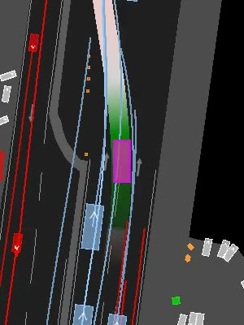

# Excel 导出功能模块

| 属性 | 值 |
| ---- | --- |
| ID | excel-export-module |
| 类型 | feature |
| 优先级 | medium |
| 状态 | done |
| 创建日期 | 2026-04-07 |
| 更新日期 | 2026-05-17 |

## 概述

提供 pandas 额外的 Excel 写入操作，支持 CR 定位任务标注/调试。将数据写入、样式、条件格式、数据验证、图片嵌入等功能解耦为独立可组合模块。

## 背景

CR 定位标注工具需要生成包含图片、条件格式、数据验证的 Excel 文件供人工审核。原版实现耦合度高、接口不统一，需要按项目规范重构。

## 范围

**在范围内：**

- 单元格文本格式调节
- 条件格式添加
- 数据验证（下拉选项）
- 图片嵌入单元格
- `col_range` 参数统一支持
- 类型注解（`Workbook`、`Worksheet`）

**不在范围内：**

- 不实现 Excel 读取功能
- 不替代 pandas 原生 `to_excel`

## 成功指标

| 指标 | 基线 | 目标 | 评价方法 |
| ---- | ---- | ---- | -------- |
| 功能完整性 | — | 4 项核心功能均可用 | Human-in-loop 测试 |
| 接口一致性 | 混用 columns/col_range | 全部统一 `col_range` | 代码审查 |
| 无回归 | — | 现有标注流程不受影响 | 手动验证 |

## 验证方案

### 测试计划

- [ ] 单元格文本格式调节（背景色、对齐）
- [ ] 条件格式添加（equal TRUE 绿色）
- [ ] 数据验证插入（`[P2F, F2P]` 选项列表）
- [ ] 图片嵌入 + 文本对齐效果

## 用户故事

- 作为数据分析师，我希望能够灵活地设置 Excel 单元格的文本格式
- 作为标注员，我希望能够添加条件格式和数据验证来辅助标注工作
- 作为开发者，我希望能够将图片嵌入到单元格中，便于可视化展示

## 需求详情

### 功能需求

1. 支持单元格文本格式调节：以背景色为绿色、底部对齐、垂直居中为例
2. 支持添加条件格式，以 equal TRUE 为例
3. 支持插入数据验证，以 `[P2F, F2P]` 选项列表为例
4. 支持图片嵌入单元格，单元格默认与图像大小一致（全部相同），也可调节留出空白，结合文本对齐供标注使用

### 技术需求

1. 按照项目风格规范重构代码
2. 使用类型注解，特别是 'Workbook' 和 'Worksheet' 的类型注解
3. 避免使用 assert，改用 raise RuntimeError
4. 支持 col_range 参数，使功能更灵活

## 相关文件

- `lib/utils/excel_utils.py` - Excel 导出功能的主要实现

## 验证方案

1. 测试单元格文本格式调节功能
2. 测试条件格式添加功能
3. 测试数据验证插入功能
4. 测试图片嵌入单元格功能

## Iterations

### Iteration 20240607.01

按上述要求 重写 lib/utils/excel_utils.py 代码，注意按风格规范，避免过度设计和弱语义 dict 满天飞

最后用 ask_question 向我确认下一步行动（如：确认接口设计），务必带上自由输入的选项。

### Iteration 20240607.02

review 反馈：

- 配置项应当支持只设置部分属性，就此而言我觉得不如前一版 dict 方式灵活
- ConditionalFormat 把 condition 和 fmt 耦合了，我觉得还是前一版 dict 组合方式更好
- 请加上 'Workbook' 和 'Worksheet' 的类型注解，避免弱语义
- 原版 write_df 是一个模板，提供锁定cell range 等写入方式，与其他函数的单元格计算语义对齐，请不要移除强制的默认值
- 因为是作为库模块，就不要用assert而是raise runtimeerror，避免被优化
- 原版 apply_conditional_format 解耦了 condition 和 fmt 的定义，提供了更灵活的接口设计，请不要耦合在一起
- apply_data_validation 为什么 单独支持 columns，与其他功能设计不统一，我倾向于每次apply一个 column range(连续的columns)，同时符合 pandas 和 excel 的语义设计
- embed_images 使用 columns 我认可，因为 操作 本来是 cell-wise 的，不是 cell range based
- embed_images 默认图像居中？业务上希望图像靠上对齐，下面留出空白区域供标注使用，参考参考图片，要不你支持统一的align参数吧
- 嗯，测试需要 human-in-loop，它还能叫单测吗？你给点意见，该支持pytest运行吗？我觉得你就不用运行了，我得自己测
- 我先跑看下结果，你自己先改

### Iteration 20240607.03

test 意见：

- apply_conditional_format 和 apply_cell_format 在一起，我怎么分得清
- excel打开看到规则里有一条 公式 =1=1 绿色
- 你加一个添加图像的测试吧，我们看下插入图像+文本对齐+数据验证的效果，你就用  反复插入，哈哈
- 可以，测试选项你加到 shebang 里呗？

review 意见：

- 你不打算改 dataclass 了嘛？要不用  TypedDict ? TypeDict 的字段就不是 tp.Optional，是required啥的来着
- 你看你还要手动 转写一遍 _xlsxwriter_fmt，还要处理 type_，多麻烦
- 抽个helper让所有功能都支持 col_range 呗
- ImageLayout 还是没有用 align 啊

### Iteration 20260408.1643

我发现 这些测试图像的尺寸并非预期的 300x400，你帮我检查下（可以用exiftool），把问题图片resize

我重新思考了并改写了 embed_images，我们先不需要 ImageLayout，只需要指定文本的 fmt，
通过 文本格式我们可以推断出唯一的图像布局方式，通过调节cell格式插入图像

例如
FORMAT_TEXT_UNDER_IMAGE
表示文本居于图像下方，所以你需要这么做

- 将cell高度调整到原高度+图像高度，宽度调整到max(图像宽度，原宽度）
- 将图像插入到cell+0,0处

fmt = None 或者居中啥的，可以视为不计算

padding 作为直接参数，增加额外 padding

最后用 ask_question 向我确认下一步行动（如：是否需要我 review 代码），务必带上自由输入的选项。

### Iteration 20260408.1756

    - Any other ``fmt`` or ``None``: cell dimensions are not adjusted; image is
      inserted with the given padding offset only.

你理解错了，fmt 只要不是完全居中，文本都可以和图片进行排版

- 再补充几种测试用例，写到同一个 book 里，sheet名字可以改
- cell 的宽高能用读取值而非默认值吗

最后用 ask_question 向我确认下一步行动（如：是否需要我 review 代码），务必带上自由输入的选项。

## 总结

已完成 Excel 导出功能模块的开发，实现了：

1. 单元格文本格式调节 - 支持背景色、对齐方式等格式设置
2. 条件格式功能 - 支持基于条件的单元格格式化
3. 数据验证功能 - 支持下拉选项等数据验证
4. 图片嵌入功能 - 支持将图片嵌入到单元格中，并可调节对齐方式
5. 按项目规范重构代码，添加了完整的类型注解和错误处理
