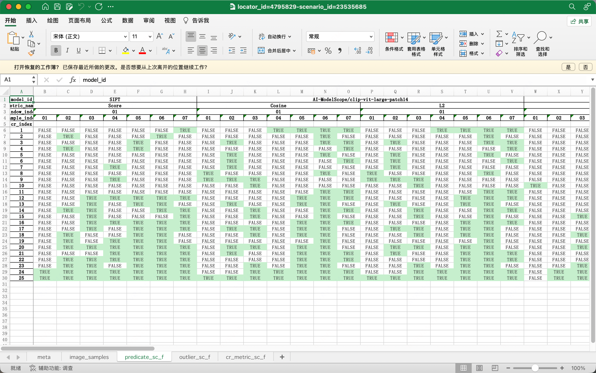
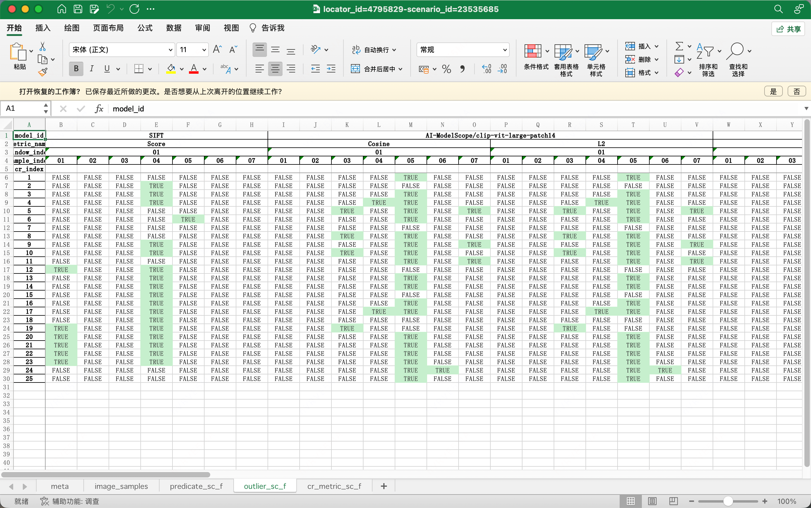
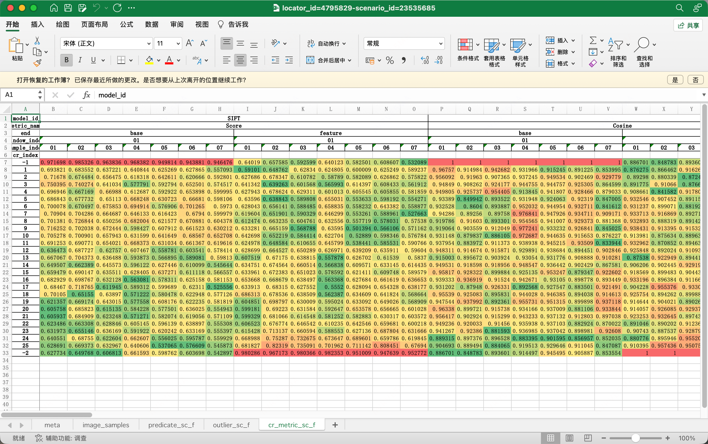

# CR 定位聚合算法优化

| 属性 | 值 |
| ---- | --- |
| ID | cr-location-aggregation-optimization |
| 类型 | task |
| 优先级 | high |
| 状态 | active |
| 创建日期 | 2026-04-07 |
| 更新日期 | 2026-05-17 |

## 概述

优化 CR 定位聚合算法，提升单拐点合理性和多拐点召回率。通过建立可量化评测方法，系统比较不同模型和算法的定位效果。

## 背景

承接 [大模型 CR 定位](../features/大模型%20CR%20定位.md)。`lib/algorithms/cr_locate.py` 作为初版聚合算法，达到了 85%+ 的一致性（DPE 基线）。当前算法偏保守（Precision > Recall），多拐点召回偏低（所有模型 13-27%），需要引入置换检验等统计方法优化。

## 范围

**在范围内：**

- 建立可量化评测方法（Recall@K / Precision@K / F1@K）
- 支持零拐点、单拐点、多拐点三种场景评测
- 主要优化方向为召回（尤其多拐点）
- 置换检验等统计学方法引入
- 充分利用 outlier 特征
- 不同模型横向对比（7 模型）

**不在范围内：**

- 不改变采样策略
- 不新增视觉特征模型（那是 VL Embedding 探索的任务）

## 成功指标

| 指标 | 基线 | 目标 | 评价方法 |
| ---- | ---- | ---- | -------- |
| overall Recall@1 | 41.9% (DINOv2-base) | ≥ 55% | 在 ≥ 49 标注样本上评测 |
| multi_cr Recall@1 | 27.2% (DINOv2-base) | ≥ 40% | multi_cr 子集（当前 n=13，随标注增加） |
| overall F1@ALL | 未测量 | ≥ 70% | 全量标注样本 |
| 评测样本规模 | 49 有效样本 | ≥ 100 | 持续标注 + 推理覆盖 |

## 需求详情

### 优化方向

1. 建立评测方法，可客观评测 基于视觉模型的判断方法同时评价 DPE metric
1. 评测方法支持
	* 零拐点
	* 单拐点
	* 多拐点
1. 主要优化方向为 **召回** (尤其多拐点)
1. 考虑置换检验（Permutation Test）等统计学方法，提升单拐点合理性、多拐点召回
2. 充分利用 outlier 特征
3. by topic 优化
1. 比较不同模型的指标差异，以筛选最优模型/评价 VL embedding 模型

## 依赖

- 人工真值标注 [CR Locator 标注手册](../../guides/cr-locator-annotation-guide.md)

- 模型推理结果，可从 DOS [te-ds-autolabeling-dos-1/luonairui/data/visual-cr-locator-api/](https://base.xiaojukeji.com/odin/guigu/#/gift/ofs/detail/voyager-te-ds/nmgpu/te-ds-autolabeling-dos-1/file/luonairui/data/visual-cr-locator-api/) 下载，可通过 S3 兼容客户端或网页 HTTP 直接下载

	* FoB（Feature over Base）判定矩阵

	

	* Outliers 矩阵

	

	* 原始推理 metric 矩阵

	

## Iteration 20260516.2340

### 阶段性总结

#### 1. 旧版评测回顾（commit d21067e, branch `eval_2`）

旧版 `lib/evaluations/` 模块包含：
- `core/`: models, metrics, annotation_loader, cr_locator, report_generator, excel_loader
- `runners/`: base_runner, dpe_runner, model_runner
- `demos/`: batch_evaluate, evaluate_all_annotation

发现的关键问题：
- **场景分类 bug**：用 `len(annotations)` 而非 `len(critical_crs)` 判断 zero/single/multi CR，导致 rank=次要/轻微 的标注被误算为 multi_cr
- **指标过于复杂**：Top-1/Top-5 Recall/Precision、Full Recall Rate、Zero-CR Accuracy 等多维度交织，实际使用混淆
- **未标注 cell 语义不清**：negative（无变化）还是 ignore（未检查）未明确区分

#### 2. 当前版本情况

- 算法层已支持多 CR 输出：`ZeroCRLocated`, `SingleCRLocated`, `MultiCRLocated`（commit `c7400b6`）
- API 层 `LocatorScenarioResult.cr_indices: list[int]` 支持多拐点
- 旧版评测代码未合入 master，停留在 `eval_2` 分支

#### 3. 新评测方案核心决策

- **指标聚焦**：Recall@K + Precision@K + F1@K（K = 1, 3, 5, ALL）
- **评测位置**：`experiments/cr-locator-eval/` 目录下
- **真值语义**：
  - 关键拐点：rank 缺失（默认）或显式 `"关键"` → gt_critical_crs
  - 次要/轻微：不计入真值但单独报告（防过度召回）
  - 未标注 CR：视为 negative
  - 场景无效（scene_invalid 非空）：排除出评测

#### 4. 已创建 worktree

- 路径：`/home/luban/workspaces/vlm-triage.worktrees/cr-locator-eval`
- 分支：`task/cr-locator-eval`（基于 master）

#### 5. 详细规划

见 session plan: `~/.copilot/session-state/90a61b66-d9a9-48cb-bd7d-e856c07ae560/plan.md`

## Iteration 20260517.0100

### 数据清洗 pipeline 完成

#### 数据源探索

**标注数据** (S3: `luonairui/data/visual-cr-locator-fe/annotations/`):
- 37 个 JSON 标注文件
- 场景分布: invalid 42%, single_cr 40%, multi_cr 16%, zero_cr 2%
- Diff 分布: F2P 60%, P2F 40%
- Rank: 绝大多数无 rank（默认=关键拐点），极少数有"次要"
- Critical CR 分布: 0个=20, 1个=18, 2个=1, 3个=3, 4个=2, 17个=1

**推理数据** (S3: `luonairui/data/visual-cr-locator-api/202604/`):
- 25 个 Excel 文件（20 个唯一 locator_id）
- 7 个模型: CLIP, AIMv2, DINOv2-b/l, SigLIP2, BLIP2, SIFT
- 3 种格式:
  1. 完整(metric+predicate+outlier+result): 10/25 — 可直接读 result_f
  2. 部分(metric+predicate+outlier): 3/25 — 需运行定位算法
  3. 最简(metric only): 6/25 — 需先算 predicate/outlier 再定位
  4. 损坏: 4/25
- **关键发现**: Excel 有 5 级列 MultiIndex (model_id, metric_name, end, window_index, sample_index)
- result_f 为旧版单 CR 输出格式

#### 清洗管道实现

- 代码位置: `experiments/cr-locator-eval/eval/pipeline.py`
- 功能: 标注 JSON → SceneAnnotation / Excel → ModelPrediction / 匹配 → EvalCacheEntry → cache JSON
- 已跑通: 37 标注 + 15 推理 → 8 个匹配样本
- 输出: `data/cache/locator_id={id}-scenario_id={scenario_id}.json` 统一格式

#### 数据分布报告

| 类型 | 数量 | 占比 |
|------|------|------|
| invalid | 4 | 50% |
| zero_cr | 0 | 0% |
| single_cr | 3 | 38% |
| multi_cr | 1 | 12% |

预测结果: MultiCRLocated 9, SingleCRLocated 47（含旧版 result_f 49）

### 评测指标实现

代码: `experiments/cr-locator-eval/eval/metrics.py`

核心指标（已实现）:
| 指标 | 计算方式 | 说明 |
|------|----------|------|
| Recall@K | \|pred_top_k ∩ gt\| / \|gt\| | 真值命中率 |
| Precision@K | \|pred_top_k ∩ gt\| / min(K, \|pred\|) | 预测精确率 |
| F1@K | 2PR/(P+R) | 综合平衡 |

- K 取值: 1, 3, 5, ALL
- 按场景类型分组: single_cr / multi_cr / overall
- 支持 7 模型横向对比

#### 首轮评测结果（8 个匹配样本，4 个有效）

| Model | overall Recall@1 | Precision@1 | F1@1 |
|-------|-----------------|-------------|------|
| 全部模型 | 58.3% | 75.0% | 65.6% |

> 注：样本量太小（n=4），各模型结果一致是因为算法在同组数据上输出相同 CR。需扩大匹配样本量后结论才有统计意义。

## Iteration 20260517.0920

### 全量数据处理 & 实验入口完成

#### 数据规模

- 标注：79 个 JSON（从 S3 全量下载）
- 推理：401 个 Excel（仅下载 72 个匹配 locator_id 的数据）
- 匹配：70 个（locator_id, scenario_id）对
- 有效样本：49 个（single_cr 36 + multi_cr 13），invalid 21 个（30%）

#### 首轮完整评测结果

| Model | overall R@1 | P@1 | F1@1 | single R@1 | multi R@1 |
|-------|------------|-----|------|-----------|----------|
| **DINOv2-base** | **41.9%** | **55.1%** | **47.6%** | **47.2%** | **27.2%** |
| SIFT | 38.7% | 49.0% | 43.2% | 44.4% | 22.8% |
| SigLIP2 | 36.9% | 46.9% | 41.3% | 41.7% | 23.8% |
| BLIP2 | 31.1% | 38.8% | 34.5% | 36.1% | 17.4% |
| DINOv2-large | 31.6% | 40.8% | 35.7% | 36.1% | 19.3% |
| AIMv2 | 30.5% | 40.8% | 34.9% | 33.3% | 22.8% |
| CLIP | 28.6% | 38.8% | 32.9% | 30.6% | 23.1% |

#### 关键发现

1. **DINOv2-base 全面最优**：single_cr R@1=47.2%，multi_cr R@1=27.2%
2. **multi_cr 召回偏低**：所有模型在 13-27%，多拐点场景是核心难点
3. **Precision > Recall**：算法偏保守，Recall 提升空间大
4. **SIFT（传统 CV）不差**：Recall 仅次于 DINOv2-base

#### 代码结构

```
experiments/cr-locator-eval/
├── README.md       # 实验文档 + 运行指南
├── config.json     # 实验配置（7 模型、12 指标、3 场景类型）
├── data/cache/     # 70 个归一化缓存 JSON
├── eval/
│   ├── models.py   # 数据模型
│   ├── pipeline.py # 数据清洗管道（标注+推理归一化）
│   └── metrics.py  # Recall@K/Precision@K/F1@K 计算
└── results/
    └── metrics.json # 评测结果
```

### 下一步

指标设计已落实。可进入算法优化迭代（置换检验、outlier 特征利用、by-topic 优化），或扩大标注覆盖。

## Iteration 20260517.0054

我觉得你先把 评测用的数据吃透吧，第一个是 标注数据 标注数据 分场景有效和无效。 有效也分 F2P P2F P2P等 x 重要 次要，如果要做top k的指标的话，就要明确排序的方式。
然后就是 算法给的结果。 由于历史版本比较多。 有的是包含 最终定位结论的有的只有中间结果还需要。 运行定位算法重新生成。 算法的结果都在data目录下面的excel 数据拍plan需要。 将。 清洗过程。 的结果保存到cache目录下 确保 有统一。 的形式以便评测 。
通过对 评测数据本身的 分布和理解的分析 我们再来优化指标的设计。 在落实成代码实现。

## Iteration 20260517.0915

invalid 42% 和 zero_cr 2% 什么关系？2个是排他的吧
Critical CR 分布: 17个=1是怎么回事，是极端case嘛？
处理全部数据适配实验接口
